# AWS EC2:  Hands-on Tutorial 

**AWS Cloud Infrastructure | Linux, Windows, networking, firewalls, protocols, SSH, RDP, VPC**  

## 1. What is Amazon EC2?

Amazon Elastic Compute Cloud (**EC2**) lets you provision virtual servers (instances) on AWS instead of buying and maintaining physical servers. You choose an operating-system image, hardware capacity, storage and network configuration, then install applications and administer the server.

**Business example:** An online shop wants to host a website and API. EC2 provides on-demand compute for Nginx/Apache/IIS and Java/.NET/Python services, and the company can increase or decrease capacity as workloads change.

**Why use EC2?** Website hosting; development and testing; Java, Python and .NET applications; Linux training; database software; batch jobs; adjustable capacity; access to global AWS Regions. EC2 is infrastructure-as-a-service (IaaS): AWS manages underlying physical infrastructure; you remain responsible for guest OS, application updates, identities and suitable network rules.

**Elasticity:** Scale *vertically* by changing instance type (usually while stopped) or *horizontally* by launching more instances behind a load balancer, typically with EC2 Auto Scaling.

## 2. Types of EC2 machines

### 2.1 Operating system / AMI

An **Amazon Machine Image (AMI)** is a launch template containing the operating system and initial software configuration.

| OS / AMI | Appropriate demonstrations | Typical access |
|---|---|---|
| Ubuntu Server 24.04 LTS | Linux, shell, SSH, Nginx, Java, Python, Docker | `ubuntu` over SSH |
| Amazon Linux 2023 | AWS-based Linux server administration | `ec2-user` over SSH |
| Windows Server 2022 | IIS, Windows administration, .NET and GUI | Administrator over RDP |
| RHEL, SUSE, Debian and others | Distribution-specific administration | Depends on AMI |

Choose an **official and appropriate** AMI, check architecture, support and price/licensing. An AMI does not automatically install every service (for example, selecting Ubuntu does not give you an RDP server).

### 2.2 Instance families

| Family | Workload | Examples |
|---|---|---|
| T | Burstable general-purpose | `t3.micro`, `t3.small`, `t4g.micro` |
| M | Balanced general-purpose | `m7i.large` |
| C | Compute-optimized | `c7i.large` |
| R | Memory-optimized | `r7i.large` |
| I / Im | Storage-optimized | Specific available sizes |
| G | Graphics/GPU | `g5.xlarge` |
| P | GPU-heavy AI and HPC | P-family |

`t3.micro` provides **2 vCPU and 1 GiB RAM**. `t4g` is ARM based; an x86_64 AMI is not interchangeable with an ARM AMI. Free Tier entitlement and pricing depend on your account; do not assume every micro instance is free.

## 3. Indian Regions and Availability Zones

- **Mumbai:** `ap-south-1` (used throughout this lab).
- **Hyderabad:** `ap-south-2`.

A **Region** is a geographic AWS location. An **Availability Zone (AZ)** is an isolated infrastructure location inside a Region. Region-specific EC2 inventories are separate: an instance created in Mumbai may not appear while viewing Hyderabad. AZ names such as `ap-south-1a` are account-relative mappings.

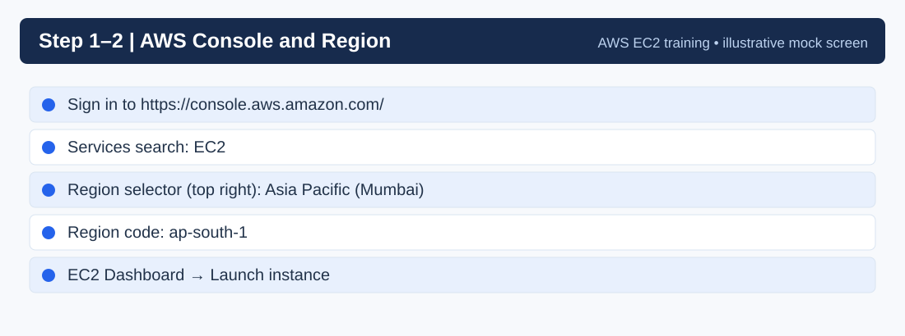

## 4. Architecture and vocabulary

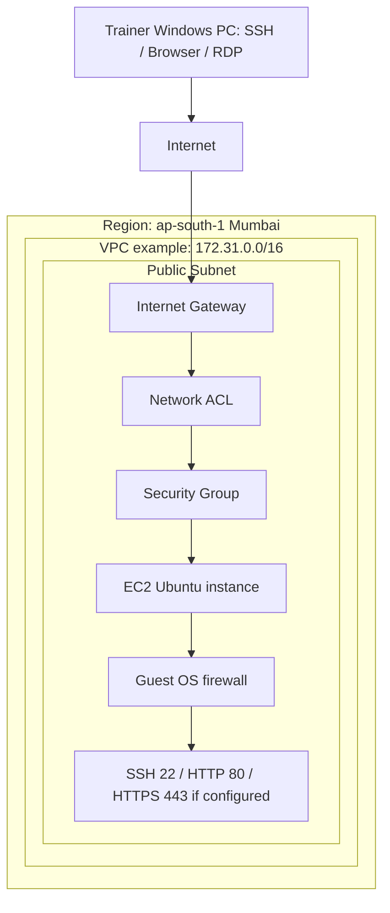

> Conceptual flow: actual packet processing also depends on addressing and routes. A public subnet alone does not make an instance publicly accessible.

| Term | Meaning |
|---|---|
| EC2 instance | Virtual server |
| AMI | OS/software image used to launch it |
| VPC | Logically isolated virtual network |
| Subnet | IP address range inside a VPC |
| Route table | Destination network to next hop mapping |
| Internet Gateway | Gateway for routed internet traffic |
| Public IPv4 | Internet-routable address assigned to instance/interface |
| Private IPv4 | VPC-internal address |
| Security Group (SG) | Stateful instance network-interface firewall |
| Network ACL (NACL) | Stateless subnet-level filter |
| EBS | Persistent block storage volumes |
| Key pair | SSH key-based authentication credentials |
| IAM role | AWS permissions assigned to an instance |
| User data | Optional startup configuration script |

## 5. Training lab specifications

| Setting | Value |
|---|---|
| Region | `ap-south-1` Mumbai |
| Name | `EC2-Linux-Network-Lab` |
| AMI | Official Ubuntu Server 24.04 LTS x86_64 |
| Instance type | `t3.micro` if offered and suitable |
| Key | `mumbai-training-key.pem` RSA |
| VPC | Default VPC |
| Subnet | Default subnet with IGW route |
| Auto-assign public IPv4 | Enabled |
| SG | `EC2-Training-SG` |
| Initial inbound | SSH TCP 22 from *My IP* `/32` only |
| Root EBS | 8 GiB `gp3` if supported by AMI |
| IAM role | None for initial lab |
| User data | Blank |

**Before launching:** Use an authorized training account, confirm quota, budget and account-level Free Tier eligibility. EC2 compute, EBS volumes and public IPv4 addresses may each incur charges.

## 6. Launch EC2: every console screen

### Step 1 — AWS sign-in / Step 2 — Select Region

1. Sign in at <https://console.aws.amazon.com/> using authorized credentials.
2. Search for **EC2** and open the EC2 service.
3. In the top-right Region selector, choose **Asia Pacific (Mumbai)** `ap-south-1`.
4. Select **Launch instance**.


### Step 3 — Name and tags / Step 4–5 — AMI

1. **Name and tags:** Set Name to `EC2-Linux-Network-Lab`.
2. **Application and OS Images (AMI):** Quick Start → **Ubuntu**.
3. Select a trustworthy **Ubuntu Server 24.04 LTS** `x86_64` AMI, and check publisher/license/AMI price.
4. Explain that Name is a tag used to find and organize instances; it does not affect the OS hostname by itself.

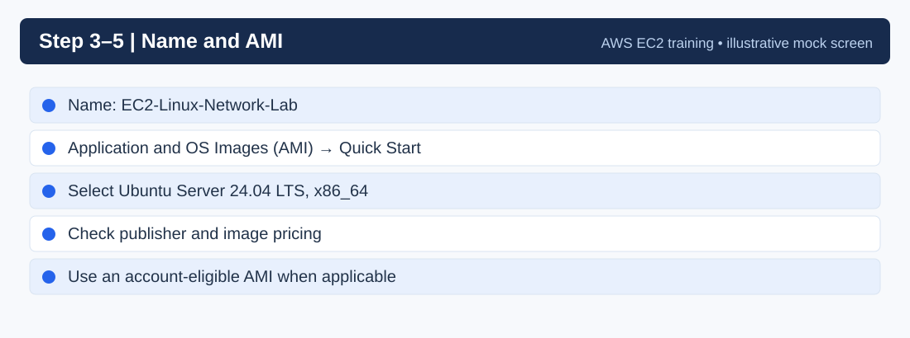

### Step 6 — Instance type / Step 7 — Key pair

1. Choose `t3.micro` if suitable and available for the account.
2. Key pair (login) → **Create new key pair**.
3. Enter `mumbai-training-key`, type **RSA**, file format **.pem**.
4. Download the private key and store it securely. Never upload to GitHub or give the same key to all students.
5. Explain the public/private key model: SSH verifies possession of the private key against an authorized public key.

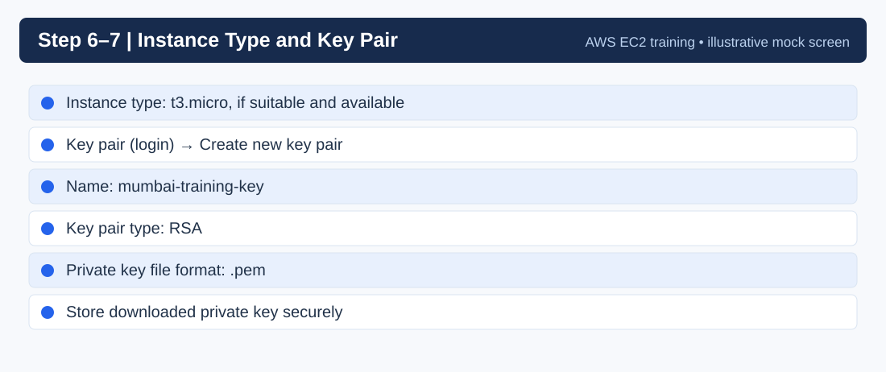

### Step 8 — Network settings

Select **Edit** under Network settings.

| Setting | Select | Why |
|---|---|---|
| VPC | Default VPC | Existing network |
| Subnet | No preference within default VPC, check IGW route | Simplifies initial setup |
| Auto-assign public IP | Enable | Direct public IPv4 connectivity |
| Firewall | Create security group | New SG for this exercise |
| Security group name | `EC2-Training-SG` | Separate lab firewall |
| Description | `EC2 networking training lab` | Identification |
| Inbound | SSH, TCP, 22, **My IP** `/32` | Limit who can attempt SSH |

Do **not** add HTTP, HTTPS, RDP, port 8080 or ICMP yet. We open them individually to demonstrate why traffic initially fails.

**Browser-based EC2 Instance Connect caveat:** When connecting through the public EC2 Instance Connect service, SSH may require a source rule for the AWS-managed `com.amazonaws.ap-south-1.ec2-instance-connect` prefix list (plus suitable IAM and supported AMI). Merely restricting source to My IP is intended for SSH from your own computer.

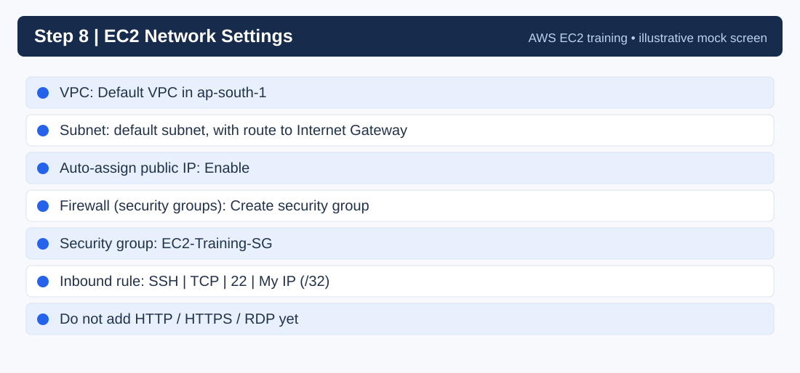

### Step 9 — Storage / Step 10 — Advanced details

- **Storage:** 8 GiB gp3 root EBS if supported, encryption if available, root `Delete on termination` enabled for a disposable machine.
- **IAM instance profile:** None; do not grant AWS service permissions not required by the workload.
- **Shutdown behavior:** Stop.
- **Detailed monitoring:** Disabled for a basic lab.
- **Stop/termination protection:** Disabled for the disposable lab; use protection for important workloads.
- **Metadata:** Prefer requiring IMDSv2.
- **User data:** Blank, since installation will be performed manually.

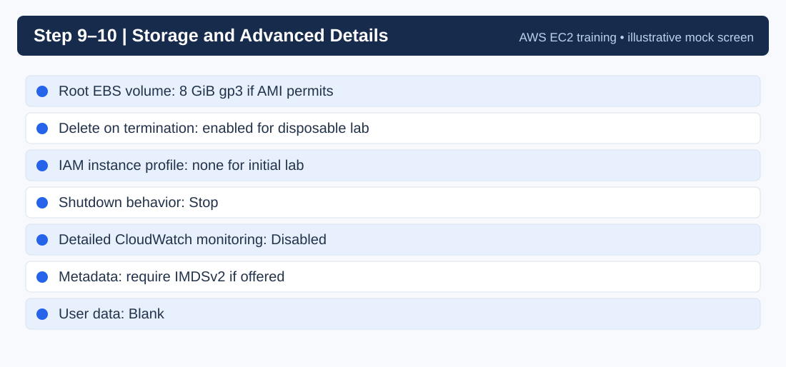

### Step 11 — Launch / Step 12 — Verify instance

1. Review right-side **Summary** including image, type, SG, key and EBS.
2. Choose **Launch instance**.
3. Go to **Instances**, select `EC2-Linux-Network-Lab`.
4. Wait until **Running** and EC2 status checks pass.
5. Copy the **Public IPv4 address**; below we use placeholder `EC2_PUBLIC_IP`.
6. Inspect tabs: **Details**, **Status and alarms**, **Monitoring**, **Security**, **Networking**, **Storage** and **Tags**. Console labels may vary.

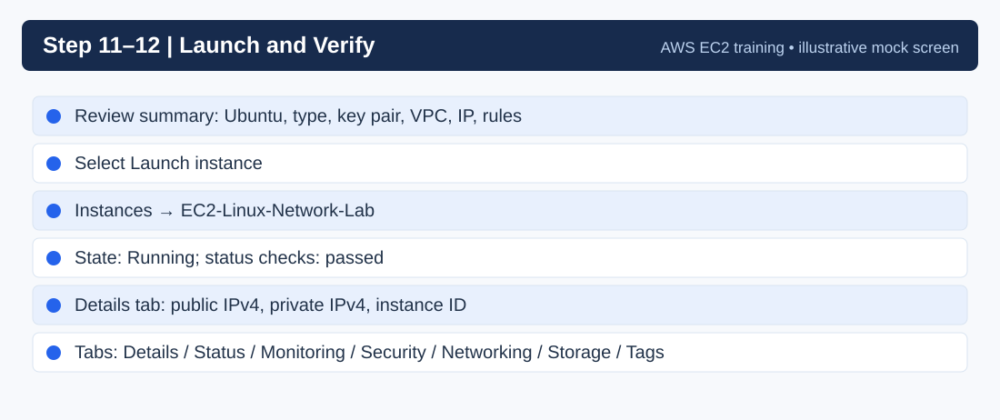

## 7. All major connection methods

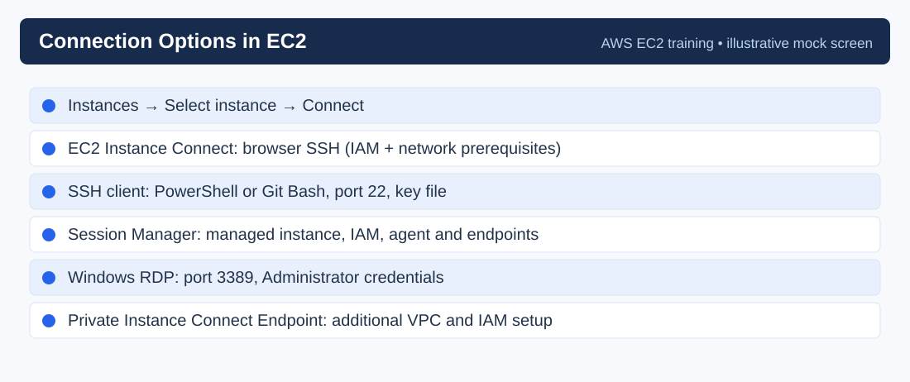

| Connection | Server OS | Prerequisites |
|---|---|---|
| Windows PowerShell SSH | Linux | OpenSSH client, SSH key, reachable port 22 |
| Git Bash SSH | Linux | SSH client, key, TCP 22 |
| PuTTY SSH | Linux | PuTTY, `.ppk`, TCP 22 |
| EC2 Instance Connect browser | Supported Linux AMI | IAM permissions + allowed SSH service source |
| Session Manager | Supported Linux/Windows | SSM Agent, instance role, endpoint access, IAM |
| RDP / `mstsc` | Windows | RDP service, TCP 3389 and Windows credentials |
| EC2 Instance Connect Endpoint | Supported configurations | Private endpoint, IAM and SG design |

### Method A — Windows PowerShell SSH

```powershell
ssh -V
cd "$HOME\Downloads"
ssh -i ".\mumbai-training-key.pem" ubuntu@EC2_PUBLIC_IP
```

Replace `EC2_PUBLIC_IP`. Check the instance's host-key fingerprint before first acceptance. Typical username is `ubuntu` for Ubuntu, `ec2-user` for Amazon Linux.

Once connected:

```bash
whoami
hostname
pwd
uname -a
ip -br addr
free -h
df -h
```

These report current username, machine hostname, working directory, kernel, network interfaces, memory and disk respectively.

### Method B — Git Bash SSH

```bash
cd ~/Downloads
chmod 400 mumbai-training-key.pem
ssh -i mumbai-training-key.pem ubuntu@EC2_PUBLIC_IP
```

On Windows, file access controls may need restricting if SSH complains that private key permissions are too open.

### Method C — PuTTY

1. Open **PuTTYgen**, import `.pem`, save `.ppk` privately.
2. Open **PuTTY** → Session: Host `EC2_PUBLIC_IP`, connection SSH, port `22`.
3. Connection → SSH → Auth → Credentials → load private key `.ppk`.
4. Open connection; log in as `ubuntu`.

### Method D — EC2 Instance Connect browser

EC2 → Instances → select instance → **Connect** → **EC2 Instance Connect**. Choose public-IP connection, username `ubuntu`, then Connect. Confirm compatible AMI, IAM and the AWS EC2 Instance Connect managed-prefix-list SSH source rule; a My IP-only SSH rule may not be sufficient.

### Method E — AWS Systems Manager Session Manager

No direct inbound SSH/RDP rule is needed when Session Manager is configured correctly. Requirements include installed/running SSM Agent, `AmazonSSMManagedInstanceCore`-style least-privilege instance role, SSM endpoint connectivity via internet egress or VPC endpoints, and the operator's IAM permissions. Use Instances → Connect → **Session Manager**.

## 8. Inbound, outbound, and connection return traffic

- **Inbound:** Traffic arriving at the EC2 interface (for example client → EC2 TCP 80).
- **Outbound:** Traffic leaving that interface (for example EC2 initiating HTTPS to fetch a package).
- **Stateful SG:** Allows replies to connections admitted by its rules without requiring a symmetric rule for the return packet.
- **Not all outgoing traffic is a reply:** A new outbound connection must satisfy SG outbound policy.

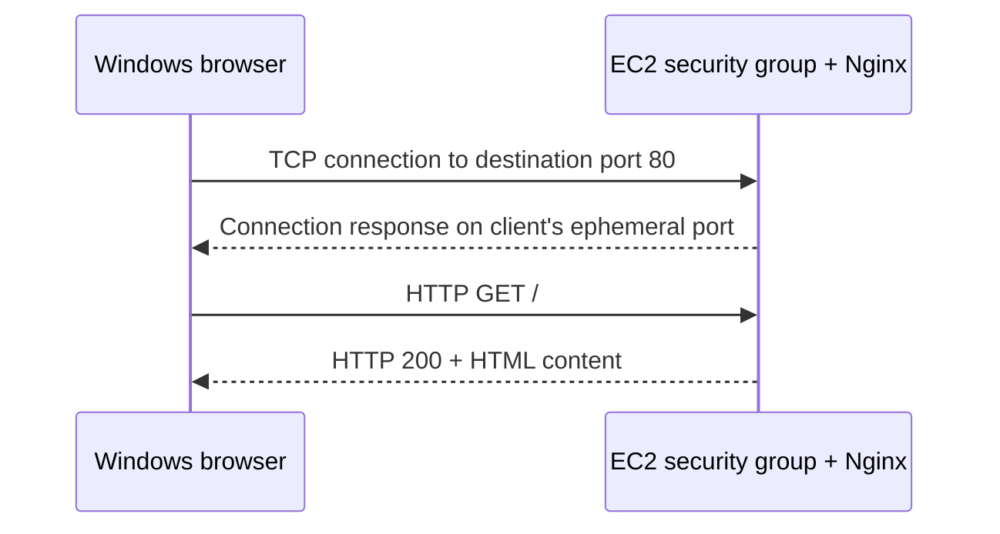

## 9. Ports and protocols

| Service | Transport | Default port | Demonstration |
|---|---|---|---|
| SSH | TCP | 22 | Linux shell |
| HTTP | TCP | 80 | Web page |
| HTTPS | TCP | 443 | TLS encrypted web page |
| RDP | TCP / UDP | 3389 | Windows desktop |
| DNS | UDP / TCP | 53 | Names to addresses |
| SMTP | TCP | 25 | Mail transfer |
| MySQL | TCP | 3306 | DB access |
| PostgreSQL | TCP | 5432 | DB access |
| SQL Server | TCP | 1433 | DB access |
| App server | TCP | 8080 | Demo web/API server |
| Ping | ICMP | No TCP/UDP port | Echo request/reply |

**Opening a port in the SG does not install or start a service.** To connect successfully, routing, every firewall layer, an active listener and any required authentication must all permit access.

## 10. Lab: Install Nginx; demonstrate TCP 80 blocked then allowed

### 10.1 Install and start

On Ubuntu:

```bash
sudo apt update
sudo apt install -y nginx
sudo systemctl enable --now nginx
sudo systemctl status nginx --no-pager
```

Expected: `Active: active (running)`.

### 10.2 Create homepage

```bash
sudo tee /var/www/html/index.html >/dev/null <<'EOF'
<!DOCTYPE html>
<html>
<head><title>AWS EC2 Networking Lab</title></head>
<body>
  <h1>Welcome to AWS EC2</h1>
  <h2>Server Region: Mumbai</h2>
  <p>HTTP Port: 80</p>
  <p>Hosted on Ubuntu with Nginx</p>
</body>
</html>
EOF

curl http://localhost
sudo ss -lntp
```

`curl` should show HTML locally, and `ss` should show Nginx listening on port 80.

### 10.3 Test from Windows *before* allowing TCP 80

Open `http://EC2_PUBLIC_IP` in Chrome. It should fail or time out because initial inbound SG only permits TCP 22 from trainer IP. Nginx itself is not necessarily broken.

### 10.4 Add HTTP rule

EC2 → Instances → select instance → Security → click `EC2-Training-SG` → Inbound rules → **Edit inbound rules** → Add rule:

| Type | Protocol | Port | Source |
|---|---|---|---|
| HTTP | TCP | 80 | Anywhere-IPv4 `0.0.0.0/0` |

Save and refresh `http://EC2_PUBLIC_IP`. The `Welcome to AWS EC2` web page should load.

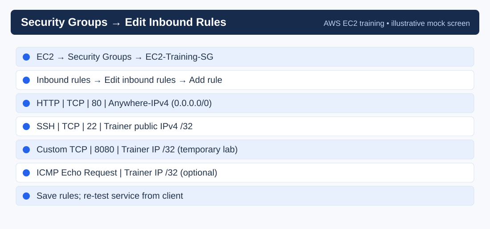

**Lesson:** Server listener was already active, but SG blocked incoming HTTP until the rule was added.

## 11. Protocol demonstration matrix

Test from **Windows PowerShell**:

```powershell
Test-NetConnection EC2_PUBLIC_IP -Port 22
Test-NetConnection EC2_PUBLIC_IP -Port 80
Test-NetConnection EC2_PUBLIC_IP -Port 443
Test-NetConnection EC2_PUBLIC_IP -Port 3389
```

| Test | Initial expected behavior | Why |
|---|---|---|
| TCP 22 from trainer IP | Connects | SSH SG rule + SSH service + key |
| TCP 80 before SG change | Fails | No inbound HTTP rule |
| TCP 80 after SG change | Connects | Nginx and inbound HTTP permission |
| TCP 443 | Fails | No HTTPS listener / no rule initially |
| TCP 3389 | Fails | Ubuntu RDP not configured / SG blocks |
| ICMP ping | Usually fails | No ICMP inbound permission initially |
| TCP 8080 | Fails initially | No custom port rule and/or listener |

**HTTP vs HTTPS:** `http://` normally uses TCP 80. `https://` normally uses TCP 443 **and requires working TLS**. Opening TCP 443 alone does not establish HTTPS or install a certificate.

**Transport vs app result:** `Test-NetConnection` tests TCP connectivity; it does not establish that SSH authentication succeeded or an HTTP status was 200.

## 12. Lab: ICMP ping

1. From Windows: `ping EC2_PUBLIC_IP` (likely timeout if ICMP not allowed).
2. EC2 SG → Edit inbound rules → add **All ICMP - IPv4** or a narrower **Echo Request** rule, source **My IP** `/32`.
3. Re-run `ping EC2_PUBLIC_IP`: echo replies should work if local and intermediate ICMP policies permit them.
4. Explain: ICMP is **not TCP/UDP** and does not have a port number; allowing ping does not open SSH/HTTP.

Ping blocked **does not prove** a server is offline.

## 13. Lab: Custom TCP port 8080

Start Python's demo HTTP server on EC2 (not for untrusted production exposure):

```bash
mkdir -p ~/port8080-lab
cd ~/port8080-lab
echo "Welcome from custom port 8080" > index.html
python3 -m http.server 8080 --bind 0.0.0.0
```

In a second SSH session:

```bash
curl http://127.0.0.1:8080
```

From Windows, `http://EC2_PUBLIC_IP:8080` should initially fail. Add SG rule **Custom TCP, TCP, 8080, My IP** `/32`, save, and retry. Browser should show the demo text. Stop Python server with **Ctrl+C**.

## 14. VPC, public/private subnets, route tables and gateways

A VPC defines your virtual network. Example CIDR design:

- VPC `10.0.0.0/16` — 65,536 total IPv4 addresses.
- Public subnet `10.0.1.0/24` — 256 total IPv4 addresses.
- Private subnet `10.0.2.0/24` — 256 total IPv4 addresses.
- AWS reserves 5 IPv4 addresses per subnet; usable allocations are fewer.

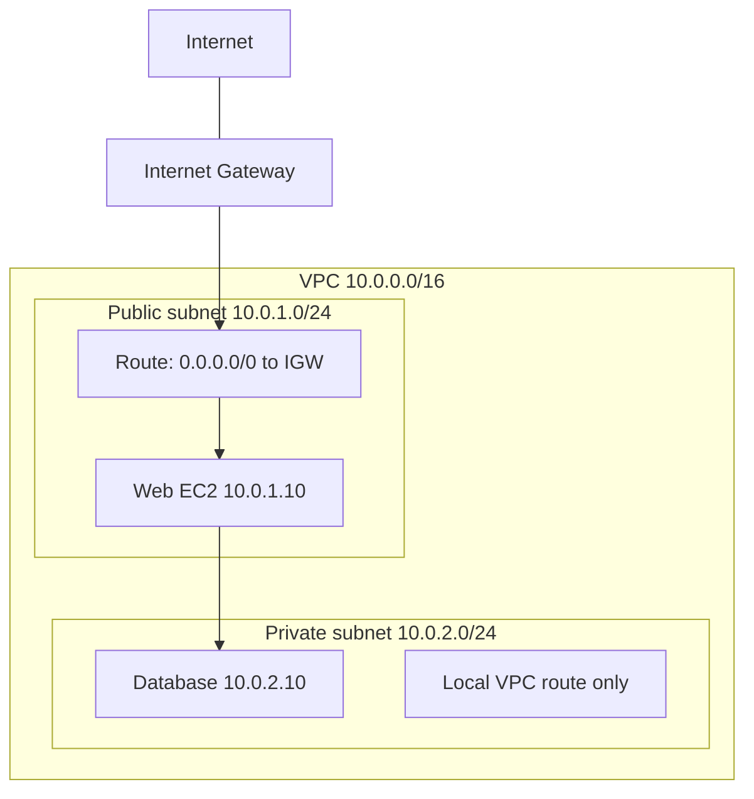

A **public subnet** is a subnet with a route to an Internet Gateway; a particular instance still needs public addressing and firewall permission for direct IPv4 internet access. A **private subnet** lacks a direct Internet Gateway route. Outbound internet from a private subnet is often provided through a NAT gateway or another controlled egress arrangement.

### Inspect networking in AWS

1. VPC console → **Your VPCs** → default VPC: inspect VPC ID and CIDR.
2. **Subnets** → find the subnet associated with your EC2 network interface.
3. **Route tables** → select the table associated with that subnet.
4. Inspect `local` VPC route and, for public subnet, `0.0.0.0/0 → igw-...`.
5. Check Internet Gateway attachment and network ACL association.

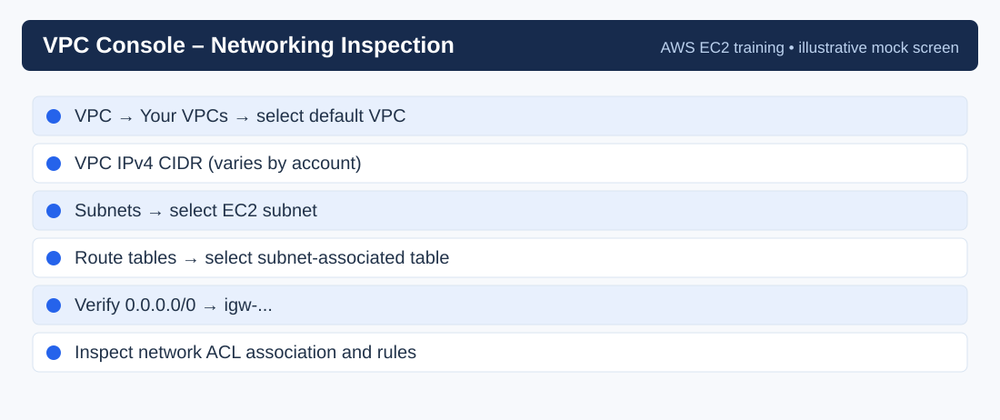

**Six checks for public IPv4 reachability:** VPC with IGW; correct subnet route; public address; permissive SG; permissive NACL and OS firewall; listening service.

## 15. Security Group vs Network ACL vs UFW

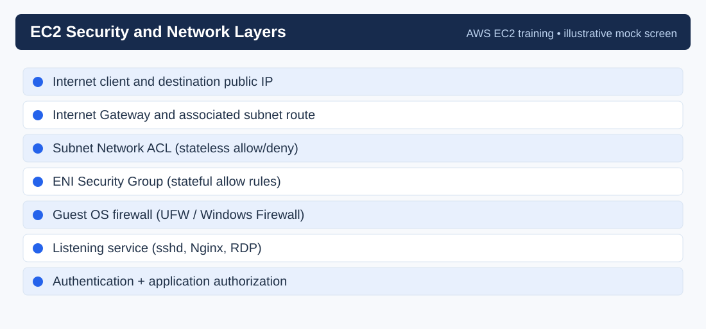

| Property | Security Group | Network ACL | Ubuntu UFW |
|---|---|---|---|
| Scope | Instance network interface | Subnet | Guest operating system |
| Stateful | Yes | **No** | Usually conntrack-based |
| Explicit deny | No | Yes | Yes |
| Return traffic | Permitted for tracked allowed flows | Must meet rule on return path | Usually tracked |
| Appropriate example | SSH from trainer IP | Subnet-level filtering | Block local web port |

### Why NACL is stateless

Client starts TCP HTTP session with ephemeral port (for example 53000) → server port 80. Response source is server port 80 → client ephemeral port 53000. Because a NACL is stateless, its inbound **and** outbound rules must permit the needed packets; it does not automatically remember the connection. The required ephemeral range depends on client/server OS and network behavior.

### UFW demonstration — block HTTP after AWS SG allows it

**Avoid SSH lockout:** Keep your current SSH session open and explicitly allow SSH before enabling UFW.

```bash
sudo ufw status verbose
sudo ufw allow 22/tcp
sudo ufw allow 80/tcp
sudo ufw enable
sudo ufw delete allow 80/tcp
sudo ufw deny 80/tcp
sudo ufw status numbered
```

From Windows refresh `http://EC2_PUBLIC_IP`; HTTP should fail even though AWS SG still allows 80. Restore:

```bash
sudo ufw delete deny 80/tcp
sudo ufw allow 80/tcp
```

This proves the AWS SG and Ubuntu firewall are independent layers.

### Source-IP experiment

Trainer's SSH source rule: `TRAINER_PUBLIC_IP/32`; student's network has another public IP. A student with the valid key but outside the allowed source range usually cannot establish TCP 22 connectivity. This separates **network authorization** from **authentication**. Keep trainer access intact while testing.

## 16. Who receives the response? Source/destination addresses

Each flow uses a distinct tuple including protocol, source IP, source port, destination IP and destination port. A web server's response goes back to the corresponding client connection, not broadcast to every user.

| Flow | Source | Destination |
|---|---|---|
| Trainer request | `192.0.2.10:52000` | `203.0.113.10:80` |
| Trainer reply | `203.0.113.10:80` | `192.0.2.10:52000` |
| Student request | `198.51.100.20:53000` | `203.0.113.10:80` |
| Student reply | `203.0.113.10:80` | `198.51.100.20:53000` |

These are **documentation-only, non-routable example IP addresses**. In reality NAT may change source IP/port as seen by the server.

On EC2 observe connections and HTTP requests:

```bash
sudo ss -tn
sudo tail -f /var/log/nginx/access.log
```

Refresh the trainer/student browsers to show request log entries. Nginx access logs record requests (not complete TCP packets); their source IP may be an upstream proxy or NAT address.

## 17. Windows EC2: RDP hands-on

Launch another EC2 instance using **official Windows Server 2022 Base** AMI, a suitable memory/storage configuration and the same Mumbai Region. Confirm pricing since Windows licensing and larger resource needs can increase cost.

| Setting | Choose |
|---|---|
| Name | `EC2-Windows-RDP-Lab` |
| Region | `ap-south-1` |
| AMI | Official Windows Server 2022 Base |
| Type | Windows-compatible, appropriately sized |
| Key pair | RSA key pair for Windows password retrieval |
| VPC | Default VPC |
| Public IP | Enable |
| SG | `Windows-RDP-Training-SG` |
| Inbound | **RDP TCP 3389** from **My IP** `/32` |
| EBS | At least the supported AMI root volume |

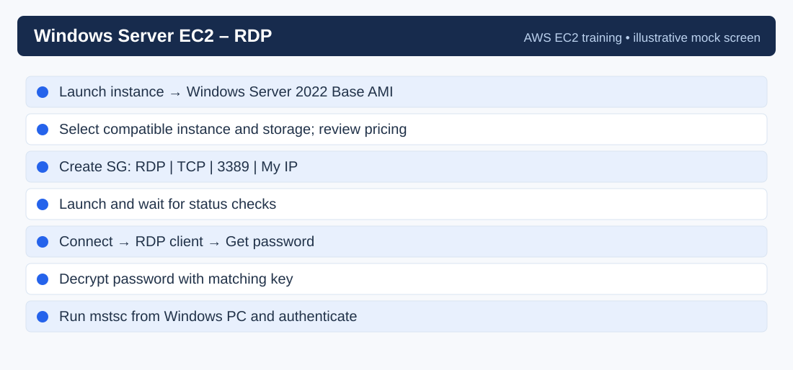

After Windows status checks pass: Instances → select → **Connect → RDP client → Get password**. Supply matching private key to decrypt Administrator password. On your Windows machine use `mstsc` and connect to EC2 public IP. Use Administrator credentials securely.

**Contrast:** Ubuntu typically has SSH on TCP 22, not an RDP server by default. Windows commonly offers RDP TCP 3389 but may not have an SSH daemon configured. Opening a port is not sufficient without a corresponding service.

## 18. Troubleshooting cheat sheet

| Symptom | Possible cause | Check |
|---|---|---|
| SSH timeout | SG, IP, routes, NACL, local network | TCP 22, public IP, subnet route |
| `Permission denied (publickey)` | Wrong key/username | `ubuntu` vs `ec2-user`, correct `.pem` |
| Connection refused | Listener absent or active reject | `sudo ss -lntp`, service and UFW |
| HTTP timeout | Port blocked / route issue | SG 80, UFW, NACL |
| HTTP 403 | Web service denies access | Nginx config, permissions |
| HTTP 404 | Missing file/path | Document root, application routing |
| HTTPS fails | TLS not configured | 443 listener, certificate, SG |
| Ping fails | ICMP rule/policy | SG ICMP, host and upstream network |
| EC2 Instance Connect fails | IAM/source rule/AMI | prefix list + supported image |
| Can't find instance | Different Region/account | Mumbai `ap-south-1` |
| `apt update` fails | No outbound access / DNS | public IP or NAT, route, egress |
| RDP fails | 3389 blocked, Windows boot/inbound service | SG, Windows firewall, status checks |

A timeout often means traffic is dropped or a route fails. **Connection refused** often means TCP reached a destination that rejected it. Neither alone pinpoints the exact root cause.

## 19. Instance lifecycle, IP and costs

- **Pending → Running:** Boot and start.
- **Stop:** Stop EBS-backed compute; some charges (EBS, allocated public IPv4, etc.) may remain. Auto-assigned public IP can change on start.
- **Start:** Restart stopped instance.
- **Reboot:** Restart guest OS without a stop/start cycle.
- **Terminate:** Permanently remove instance; associated volumes marked delete-on-termination are deleted. Extra volumes/snapshots may remain.
- **Resize:** Changing instance type typically requires stopping.

To clean up: EC2 → Instances → terminate lab instances; check residual EBS volumes/snapshots, Elastic IPs and other billable resources; remove unused groups and review Billing. Do not terminate shared or production resources.

## 20. Suggested 14-step classroom progression

| Lab | Demonstrate | Outcome |
|---|---|---|
| 1 | Create Ubuntu in Mumbai | Understand EC2 setup |
| 2 | SSH PowerShell/Git Bash | Keys and TCP 22 |
| 3 | Start Nginx without SG 80 | Blocked traffic vs running listener |
| 4 | Open SG TCP 80 | Firewall allow |
| 5 | Try HTTPS without TLS | Port alone not enough |
| 6 | Permit ICMP | Ping vs TCP |
| 7 | Run Python TCP 8080 | Custom service port |
| 8 | Limit SSH source to trainer IP | Source filtering |
| 9 | UFW deny HTTP | Layered firewalls |
| 10 | Inspect VPC/subnet/routes | Internet routing |
| 11 | Observe Nginx logs/TCP sockets | Client/server response |
| 12 | Launch Windows and RDP | Different OS/protocol |
| 13 | Discuss Session Manager | Private admin access |
| 14 | Stop/terminate | Lifecycle and cost |

## 21. Security group scenario quick reference

| Scenario | Inbound security group rule | Source |
|---|---|---|
| Trainer SSH | TCP 22 | Trainer public IP `/32` |
| Public EC2 Instance Connect | TCP 22 | AWS-managed regional service prefix list |
| Public HTTP site | TCP 80 | `0.0.0.0/0` |
| Public HTTPS site | TCP 443 | `0.0.0.0/0` |
| Trainer RDP | TCP 3389 | Trainer IP `/32` |
| Development server | TCP 8080 | Trainer IP `/32` |
| Ping test | ICMP Echo Request | Trainer IP `/32` |
| Private MySQL | TCP 3306 | Application server security group |
| Private PostgreSQL | TCP 5432 | Application server security group |

**Production guidance:** Keep SSH/RDP and databases private where practical. Use IAM least privilege, Session Manager, tight SG rules, monitored applications, approved patching and TLS. Avoid `0.0.0.0/0` for administrative or database ports.

## 23. Final recap

The core access checklist is:

**Destination IP and protocol → subnet route → Internet Gateway (when required) → Network ACL → Security Group → OS firewall → listening service → application/user authentication → valid response path.**

A server may be healthy but inaccessible because a networking control blocks it. A firewall may permit a port but no program is listening. HTTPS requires real TLS configuration. ICMP ping and HTTP are different protocols. Stateful SGs automatically allow response traffic for tracked permitted connections, whereas stateless NACLs require return-path rules.

---


