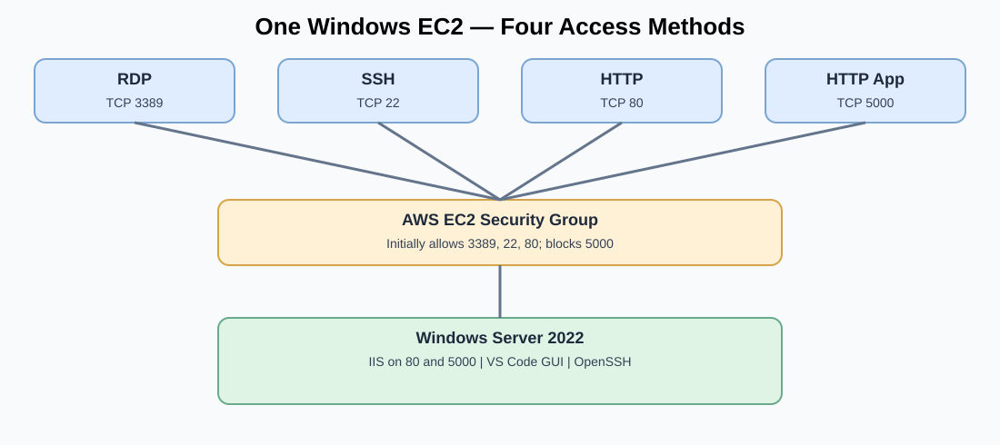
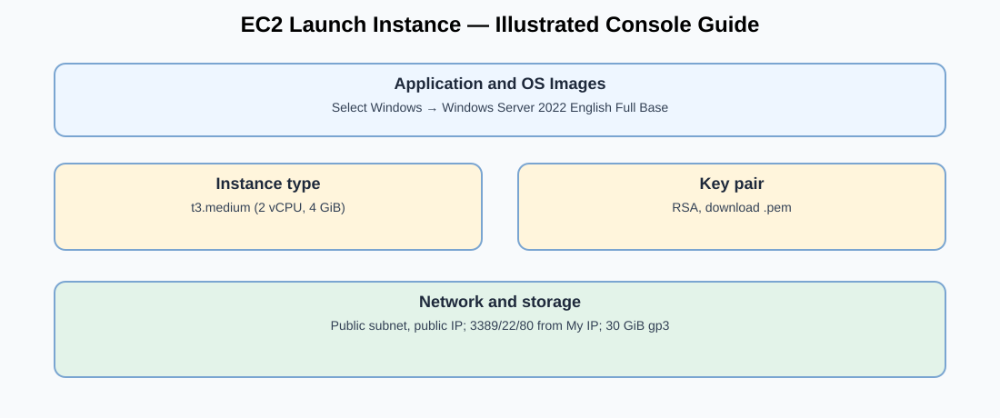
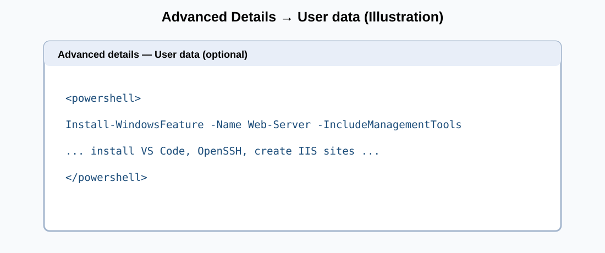
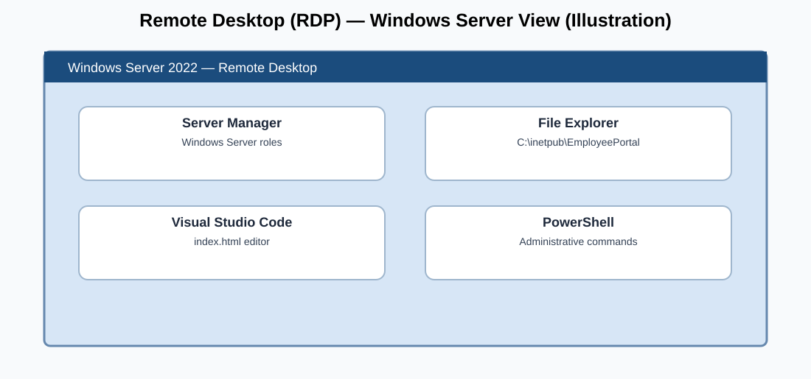
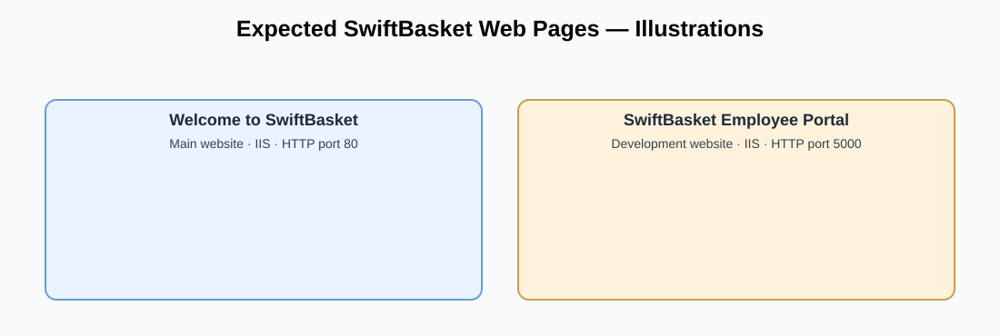
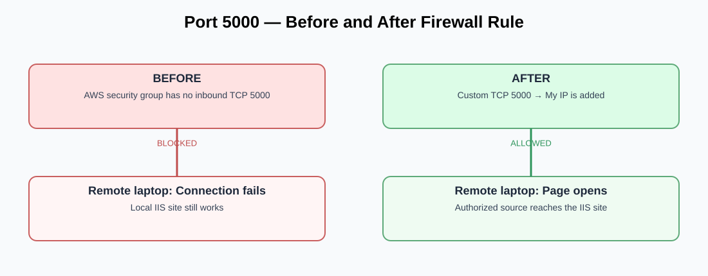
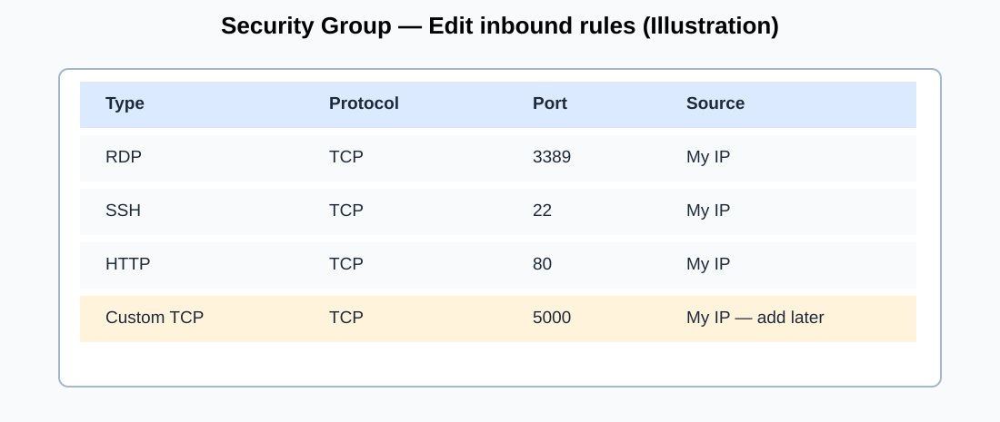

# AWS EC2 Windows Server 2022 — Automatic IIS, VS Code and SSH Installation

**Complete beginner hands-on lab · EC2 User Data · PowerShell Automation · IIS Websites · RDP · SSH · HTTP · Port 5000 Firewall Demonstration**

We are going to create **one Windows Server 2022 EC2 instance** and automatically install three things during its first startup:

1. **IIS Web Server** — to host websites on ports 80 and 5000.
2. **Visual Studio Code** — to edit the website files using the Windows desktop.
3. **OpenSSH Server** — to connect to Windows using a command-line terminal.

The most important experiment will be demonstrating that **an application can be running perfectly on EC2 but cannot be accessed from your laptop because its inbound security-group rule is missing**.

## 1. Our real-world scenario

Imagine SwiftBasket is developing a new employee portal.

The company already has a public website running on port 80. A developer creates a new employee application running on port 5000.

Initially, the employee application must be accessible only inside the EC2 server. Later, the network administrator will allow access from the developer's laptop.



*Port 5000 will be configured in IIS and Windows Firewall from the beginning. Only its AWS inbound rule will be missing, so the firewall experiment has one clear variable.*

## 2. Understand what RDP, SSH and HTTP display

| Connection | Port | What you see | Can you open VS Code? |
|---|---:|---|---|
| RDP | 3389 | Complete Windows desktop | **Yes**, graphical VS Code |
| SSH | 22 | Windows command prompt or PowerShell | You can edit files and run commands, but not directly view the VS Code GUI |
| HTTP | 80 | Main SwiftBasket webpage | No, only the webpage |
| HTTP | 5000 | Employee Portal webpage | No, only the webpage |

**Important:** The webpage on port 5000 is served by IIS, so it does not depend on a separate Python or .NET process. This keeps the first lab simple while demonstrating the exact same inbound-port restriction that would apply to a Python Flask or .NET application.

## 3. Step 1 — Launch EC2 and choose your settings

Go to **AWS Console → EC2 → Instances → Launch instances**.



Configure the following:

| EC2 option | Choose | Why |
|---|---|---|
| Name | `Windows-IIS-VSCode-Lab` | Identify the instance |
| AMI | Windows Server 2022 English Full Base | Windows desktop and server features |
| Instance type | `t3.medium` | 2 vCPU, 4 GiB RAM for basic Windows administration |
| Key pair | New RSA `.pem` file | Retrieve initial Administrator password |
| VPC | Existing default VPC or your configured VPC | Provides networking |
| Subnet | Public subnet | Direct RDP/HTTP lab connectivity |
| Auto-assign public IP | Enable | Access using public IPv4 |
| Storage | 30 GiB gp3, or the AMI's supported minimum | Windows system drive |

Select **My IP** for the RDP and SSH rules. Do not expose management ports 3389 or 22 to Anywhere IPv4.

If no default VPC exists, create one through **VPC → Your VPCs → Actions → Create default VPC**, or use a custom VPC with an internet gateway and correctly routed public subnet.

### Configure inbound firewall rules

Under **Network settings → Edit → Create security group**, enter:

`Windows-IIS-VSCode-SG`

Add only these three inbound rules initially:

| Type | Protocol | Port | Source |
|---|---|---:|---|
| RDP | TCP | 3389 | My IP |
| SSH | TCP | 22 | My IP |
| HTTP | TCP | 80 | My IP |

**Do not add port 5000 yet.** That is deliberate.

Keep the default outbound rule for this simple lab so the instance can reach the official software download sources:

`All traffic → 0.0.0.0/0`

The instance must have working outbound internet connectivity for VS Code download and Windows optional-feature installation.

## 4. Step 2 — What is Advanced details → User Data?

Scroll down to **Advanced details** at the bottom of the EC2 launch page.

Expand it and find **User data — optional**.



**User Data** allows you to supply a startup script that AWS's Windows launch agent executes when the instance is first created.

Instead of manually connecting through RDP and installing software, we will automate the process.

### Without User Data

You would need to connect through RDP, open PowerShell, install IIS, download VS Code, install OpenSSH, create files, configure IIS sites, and add Windows Firewall rules.

### With User Data

The EC2 Windows launch agent executes those configuration steps automatically during first startup.

AWS Windows AMIs use EC2Launch to handle startup scripts. The XML `<powershell>` format is supported on EC2Launch v2. By default, User Data runs once at initial launch; it is not necessary to enable execution on every reboot.

References: [EC2 User Data](https://docs.aws.amazon.com/AWSEC2/latest/UserGuide/user-data.html), [EC2Launch v2](https://docs.aws.amazon.com/AWSEC2/latest/UserGuide/ec2launch-v2.html).

---

## 5. Step 3 — Copy this complete User Data script

Paste the following script directly into the **Advanced details → User data** text area.

This script will:

- Install IIS.
- Create the main website on port 80.
- Create an Employee Portal website on port 5000.
- Install VS Code using its official Windows system installer.
- Install and start OpenSSH Server.
- Create Windows Firewall allow rules for ports 80, 5000 and 22.
- Save a setup log to `C:\EC2Lab\setup.log`.

```powershell
<powershell>

$ErrorActionPreference = "Stop"

# --------------------------------------------
# STEP 1 - Create setup folder and log
# --------------------------------------------

New-Item -Path "C:\EC2Lab" `
    -ItemType Directory -Force | Out-Null

Start-Transcript -Path "C:\EC2Lab\setup.log" -Append

try {

    Write-Output "Starting AWS Windows EC2 configuration..."

    # --------------------------------------------
    # STEP 2 - Install IIS Web Server
    # --------------------------------------------

    Install-WindowsFeature -Name Web-Server `
        -IncludeManagementTools

    Import-Module WebAdministration

    Set-Service W3SVC -StartupType Automatic
    Start-Service W3SVC

    Write-Output "IIS installation completed."


    # --------------------------------------------
    # STEP 3 - Main website on port 80
    # --------------------------------------------

    $mainHtml = @'
<!DOCTYPE html>
<html>
<head>
    <meta charset="utf-8">
    <title>SwiftBasket Main Website</title>
    <style>
        body {
            font-family: Arial;
            text-align: center;
            padding: 70px;
            background: #eaf3ff;
        }
        h1 { color: #1769aa; }
    </style>
</head>
<body>
    <h1>Welcome to SwiftBasket</h1>
    <h2>Running on AWS Windows Server 2022</h2>
    <p>IIS Web Server - Port 80</p>
    <p>This is our public-facing website demo.</p>
</body>
</html>
'@

    Set-Content `
        -Path "C:\inetpub\wwwroot\index.html" `
        -Value $mainHtml `
        -Encoding UTF8

    Write-Output "Main website created on port 80."


    # --------------------------------------------
    # STEP 4 - Employee Portal on port 5000
    # --------------------------------------------

    $portalPath = "C:\inetpub\EmployeePortal"

    New-Item -Path $portalPath `
        -ItemType Directory -Force | Out-Null

    $portalHtml = @'
<!DOCTYPE html>
<html>
<head>
    <meta charset="utf-8">
    <title>SwiftBasket Employee Portal</title>
    <style>
        body {
            font-family: Arial;
            text-align: center;
            padding: 70px;
            background: #fff2db;
        }
        h1 { color: #a85f00; }
    </style>
</head>
<body>
    <h1>SwiftBasket Employee Portal</h1>
    <h2>Application Running on Port 5000</h2>
    <p>Hosted using Microsoft IIS</p>
    <p>Initially blocked by AWS Security Group.</p>
</body>
</html>
'@

    Set-Content `
        -Path "$portalPath\index.html" `
        -Value $portalHtml `
        -Encoding UTF8

    New-Website `
        -Name "EmployeePortal" `
        -Port 5000 `
        -IPAddress "*" `
        -PhysicalPath $portalPath

    # Allow IIS to serve index.html automatically
    Add-WebConfigurationProperty `
        -PSPath "IIS:\" `
        -Filter "system.webServer/defaultDocument/files" `
        -Name "." `
        -Value @{value="index.html"} `
        -Location "EmployeePortal" `
        -ErrorAction SilentlyContinue

    Start-Website -Name "EmployeePortal"

    Write-Output "Employee Portal created on port 5000."


    # --------------------------------------------
    # STEP 5 - Windows Firewall inbound rules
    # --------------------------------------------

    foreach ($port in @(80,5000)) {

        New-NetFirewallRule `
            -DisplayName "EC2Lab IIS TCP $port" `
            -Direction Inbound `
            -Protocol TCP `
            -LocalPort $port `
            -Action Allow `
            -ErrorAction SilentlyContinue
    }

    Write-Output "Windows Firewall website rules configured."

} catch {
    Write-Output "WEB SETUP ERROR: $($_.Exception.Message)"
}

# --------------------------------------------
# STEP 6 - Install Visual Studio Code
# --------------------------------------------

try {

    $downloadUrl = "https://update.code.visualstudio.com/latest/win32-x64/stable"

    $installer = "C:\EC2Lab\VSCodeSetup.exe"

    Invoke-WebRequest `
        -Uri $downloadUrl `
        -OutFile $installer `
        -UseBasicParsing

    $process = Start-Process `
        -FilePath $installer `
        -ArgumentList "/VERYSILENT /SUPPRESSMSGBOXES /NORESTART /SP-" `
        -Wait -PassThru

    if ($process.ExitCode -ne 0) {
        throw "VS Code installer exit code: $($process.ExitCode)"
    }

    Write-Output "VS Code installation completed."

} catch {
    Write-Output "VSCODE SETUP ERROR: $($_.Exception.Message)"
}

# --------------------------------------------
# STEP 7 - Install OpenSSH Server
# --------------------------------------------

try {

    $sshCapability = Get-WindowsCapability -Online `
        -Name "OpenSSH.Server~~~~0.0.1.0"

    if ($sshCapability.State -ne "Installed") {

        Add-WindowsCapability -Online `
            -Name "OpenSSH.Server~~~~0.0.1.0"
    }

    Set-Service sshd -StartupType Automatic
    Start-Service sshd

    if (-not (Get-NetFirewallRule `
        -Name "OpenSSH-Server-In-TCP" `
        -ErrorAction SilentlyContinue)) {

        New-NetFirewallRule `
            -Name "OpenSSH-Server-In-TCP" `
            -DisplayName "OpenSSH Server" `
            -Direction Inbound `
            -Protocol TCP `
            -LocalPort 22 `
            -Action Allow
    }

    Write-Output "OpenSSH installation completed."

} catch {
    Write-Output "SSH SETUP ERROR: $($_.Exception.Message)"
}

# --------------------------------------------
# STEP 8 - Final verification
# --------------------------------------------

Write-Output "Checking services..."

Get-Service W3SVC,sshd -ErrorAction SilentlyContinue

Get-Website | Select-Object Name, State, Bindings

Write-Output "AWS Windows EC2 User Data finished."

Stop-Transcript

</powershell>
```

### Important instructions before launching

The script is for **Windows Server 2022 Full Base on an x64 EC2 instance**, using an AWS Windows AMI with EC2Launch.

Leave **User data has already been base64 encoded** unchecked. AWS will encode the script for you.

Do not add `<persist>true</persist>`, since we only want to install software during the first boot.

The script contains error handling for installation failures, so always check the setup log. A `running` EC2 state does not prove that VS Code, IIS, and SSH have all installed successfully.

VS Code uses the official x64 System Installer, which installs machine-wide under `Program Files`.

Reference: [VS Code Windows installation](https://code.visualstudio.com/docs/setup/windows).

---

## 6. Understand each software installation command

### A. IIS installation

```powershell
Install-WindowsFeature -Name Web-Server -IncludeManagementTools
```

| Part | Explanation |
|---|---|
| `Install-WindowsFeature` | Installs a Windows Server role or feature |
| `Web-Server` | IIS Web Server role |
| `-IncludeManagementTools` | Includes IIS management tools |

This is equivalent to installing the Web Server role through Server Manager.

### B. VS Code installation

```powershell
Invoke-WebRequest `
    -Uri "https://update.code.visualstudio.com/latest/win32-x64/stable" `
    -OutFile "C:\EC2Lab\VSCodeSetup.exe"
```

Downloads the current stable Windows x64 **System Installer** directly from Microsoft's VS Code update service.

Then:

```powershell
Start-Process `
    -FilePath "C:\EC2Lab\VSCodeSetup.exe" `
    -ArgumentList "/VERYSILENT /SUPPRESSMSGBOXES /NORESTART /SP-" `
    -Wait
```

| Argument | Purpose |
|---|---|
| `/VERYSILENT` | Installs without the usual setup wizard |
| `/SUPPRESSMSGBOXES` | Suppresses supported setup message boxes |
| `/NORESTART` | Prevents the installer from automatically restarting Windows |
| `/SP-` | Suppresses the initial setup prompt |
| `-Wait` | Waits until the installer process finishes |

VS Code is a desktop editor. It is not a web server and does not make port 5000 accessible by itself.

### C. SSH installation

```powershell
Add-WindowsCapability -Online `
    -Name OpenSSH.Server~~~~0.0.1.0
```

Installs the Windows OpenSSH Server optional capability.

```powershell
Set-Service sshd -StartupType Automatic
Start-Service sshd
```

Configures SSH to start automatically and starts it immediately.

Reference: [Microsoft OpenSSH Server setup](https://learn.microsoft.com/en-us/windows-server/administration/openssh/openssh_install_firstuse).

### D. Create IIS website on port 5000

```powershell
New-Website `
    -Name "EmployeePortal" `
    -Port 5000 `
    -IPAddress "*" `
    -PhysicalPath "C:\inetpub\EmployeePortal"
```

This is the most important command for our experiment.

It tells IIS:

- The website name is `EmployeePortal`.
- Listen on TCP port `5000`.
- Accept requests on applicable local IP addresses.
- Serve files from `C:\inetpub\EmployeePortal`.

It does **not** open port 5000 in the AWS Security Group.

---

## 7. Step 4 — Launch the instance and check automatic installation

After pasting User Data:

1. Scroll to the right-side **Summary** panel.
2. Verify Windows Server 2022 and `t3.medium`.
3. Confirm your key pair.
4. Confirm the inbound rules are 3389, 22 and 80 only.
5. Click **Launch instance**.
6. Open **EC2 → Instances** and select the new instance.
7. Verify the instance is running and its status checks pass.

### Connect using RDP

Select **Connect → RDP client → Get password**.

Upload your `.pem` private key, decrypt the password, and use the downloaded RDP file or the `mstsc` command on your Windows laptop.

Once connected, you should see the graphical Windows Server desktop.

### Verify User Data execution

Open PowerShell as Administrator inside EC2.

First, read our setup log:

```powershell
Get-Content C:\EC2Lab\setup.log -Tail 80
```

Check whether the script reported:

- IIS installation completed.
- Main website created on port 80.
- Employee Portal created on port 5000.
- VS Code installation completed.
- OpenSSH installation completed.

If the log is missing or incomplete, check the EC2Launch v2 log:

```powershell
Get-Content `
 "C:\ProgramData\Amazon\EC2Launch\log\agent.log" `
 -Tail 100
```

This is the documented launch-agent log location for EC2Launch v2.

### Verify installed software

Run these commands inside Windows EC2:

```powershell
# IIS
Get-Service W3SVC

# SSH
Get-Service sshd

# IIS websites
Import-Module WebAdministration
Get-Website

# VS Code
Test-Path "C:\Program Files\Microsoft VS Code\Code.exe"
```

Expected IIS sites:

```text
Name             State      Binding
----             -----      -------
Default Web Site Started    http *:80:
EmployeePortal   Started    http *:5000:
```

The exact formatting may differ.

If the Employee Portal site was created but did not start, check:

```powershell
Start-Website -Name "EmployeePortal"
```

If the VS Code installer failed, read `C:\EC2Lab\setup.log` and run the downloaded installer manually through RDP after verifying its source and integrity. Windows optional-feature installation can also fail if Windows Update connectivity or policy is restricted.

---

## 8. Step 5 — Demonstrate RDP

### What can RDP do?

RDP gives you the graphical desktop of your EC2 Windows Server.

Using RDP, you can:

- Open Server Manager.
- Open File Explorer.
- Launch VS Code.
- Edit HTML and CSS.
- Open IIS Manager.
- Install applications.
- Run PowerShell and Command Prompt.



### Test RDP from your laptop

Open PowerShell on your local machine:

```powershell
Test-NetConnection YOUR_EC2_PUBLIC_IP -Port 3389
```

Expected: `TcpTestSucceeded : True`.

Then:

```powershell
mstsc
```

Enter the EC2 public IP and your Windows Administrator credentials.

### Open VS Code through RDP

Inside the remote Windows desktop, open **Start → Visual Studio Code**, or navigate to:

```text
C:\Program Files\Microsoft VS Code\Code.exe
```

In VS Code, choose **File → Open Folder** and open:

```text
C:\inetpub\EmployeePortal
```

Open `index.html`, modify the heading, and save the file.

For example, change it to:

```html
<h1>Welcome to SwiftBasket Employee Portal - Version 2</h1>
```

This demonstrates why administrators or developers use RDP: **they can interact with the graphical development environment installed on the cloud machine**.

---

## 9. Step 6 — Demonstrate SSH

SSH provides secure command-line access instead of a Windows desktop.

### Test the port from your laptop

```powershell
Test-NetConnection YOUR_EC2_PUBLIC_IP -Port 22
```

Expected, if SSH installed successfully and both firewalls allow it: `TcpTestSucceeded : True`.

### Connect from your laptop

```powershell
ssh Administrator@YOUR_EC2_PUBLIC_IP
```

Verify the server's SSH host-key fingerprint before accepting the first connection.

For this restricted beginner lab, you can use the Windows Administrator password if password authentication is enabled in OpenSSH. In production, prefer a dedicated least-privilege account with SSH key authentication.

Once connected, execute:

```powershell
hostname
```

View the website file:

```powershell
type C:\inetpub\EmployeePortal\index.html
```

Check the SSH service from PowerShell:

```powershell
powershell -Command "Get-Service sshd"
```

You can also modify application files from the command line if your account has the necessary permissions.

### What SSH cannot show directly

SSH normally does not give you the complete Windows graphical desktop.

Running the VS Code GUI from an ordinary SSH session does not display the application on your laptop.

For this lab:

- Use RDP for the graphical VS Code editor.
- Use SSH for terminal commands.
- Use HTTP for viewing the application.

---

## 10. Step 7 — Test website on port 80

Now open Chrome on your laptop.

Enter:

```text
http://YOUR_EC2_PUBLIC_IP
```

You should see the SwiftBasket main website.



*Illustration of the expected webpages, not a live view of your EC2 instance.*

### Why does port 80 work?

Because all three requirements are satisfied:

1. IIS is listening on port 80.
2. Windows Firewall allows HTTP.
3. The AWS Security Group permits TCP 80 from your laptop's public IP.

Test from your laptop:

```powershell
Test-NetConnection YOUR_EC2_PUBLIC_IP -Port 80
```

Expected: `TcpTestSucceeded : True`.

---

## 11. Step 8 — The most important experiment: Port 5000 is running but blocked

This is where students will understand AWS firewall rules clearly.

### Scenario

The SwiftBasket development team has created a new Employee Portal.

The application is running on port 5000 on the EC2 Windows Server.

However, the AWS network administrator has not yet allowed inbound connections to that port.

### Experiment A — Verify the application locally

Inside the **Windows EC2 RDP session**, open Edge or another browser.

Enter:

```text
http://localhost:5000/index.html
```

Expected: the Employee Portal opens.


*Expected local page. We use `/index.html` explicitly so the test does not depend on IIS default-document configuration.*

This proves that the application exists and IIS is serving it locally.

### Experiment B — Test port 5000 locally

Inside Windows EC2 PowerShell:

```powershell
Test-NetConnection localhost -Port 5000
```

Expected:

```text
TcpTestSucceeded : True
```

You can also verify the listener:

```powershell
Get-NetTCPConnection -LocalPort 5000 -State Listen
```

### Experiment C — Test from your laptop

Return to your **local Windows 11 computer**, not the RDP session.

Open Chrome:

```text
http://YOUR_EC2_PUBLIC_IP:5000/index.html
```

Expected: the browser cannot establish a connection.

Then run:

```powershell
Test-NetConnection YOUR_EC2_PUBLIC_IP -Port 5000
```

Expected:

```text
TcpTestSucceeded : False
```

### Why does it fail?

The application is running. IIS is listening. Windows Firewall has an allow rule.

But the AWS Security Group does **not** have an inbound rule for TCP port 5000.



**What students learn:** A running application does not automatically become accessible from outside the machine. Network access must be configured separately.

---

## 12. Step 9 — Modify the AWS Security Group to allow port 5000

Now we act as the AWS network administrator.

### Step 1 — Open the EC2 Security Group

In AWS Console:

1. Navigate to **EC2 → Instances**.
2. Select `Windows-IIS-VSCode-Lab`.
3. Click the **Security** tab.
4. Click the linked security group ID.
5. Select **Inbound rules**.
6. Click **Edit inbound rules**.



### Step 2 — Add the new rule

Click **Add rule**.

Set:

| Setting | Value |
|---|---|
| Type | Custom TCP |
| Protocol | TCP |
| Port range | `5000` |
| Source | My IP |
| Description | Employee Portal developer access |

Click **Save rules**.

### Why choose Custom TCP?

The AWS predefined HTTP rule normally sets port 80 automatically.

Our Employee Portal uses HTTP on a nonstandard port: 5000.

Therefore, choose **Custom TCP** and explicitly enter `5000`.

### Why choose My IP?

This is an internal development application. You do not want every person on the internet to access it.

Selecting My IP restricts access to clients whose connections originate from the detected public IPv4 address.

If the company's developers use a known corporate VPN address range, you could enter that range using **Custom** instead.

### Step 3 — Test again from your laptop

Open Chrome:

```text
http://YOUR_EC2_PUBLIC_IP:5000/index.html
```

Now the Employee Portal should open.

Run:

```powershell
Test-NetConnection YOUR_EC2_PUBLIC_IP -Port 5000
```

Expected:

```text
TcpTestSucceeded : True
```

### Before vs after


No EC2 restart, IIS restart, or application restart is necessary just to add the AWS inbound rule.

---

## 13. Step 10 — Compare the four access methods

| Test | Where you perform it | Address or command | Expected result |
|---|---|---|---|
| RDP | Your laptop | `mstsc` → EC2 public IP | Windows desktop |
| SSH | Your laptop | `ssh Administrator@PUBLIC_IP` | Windows terminal |
| HTTP 80 | Your laptop browser | `http://PUBLIC_IP` | SwiftBasket website |
| HTTP 5000 before rule | Your laptop browser | `http://PUBLIC_IP:5000/index.html` | Connection fails |
| HTTP 5000 after rule | Your laptop browser | Same address | Employee Portal |
| HTTP 5000 locally | EC2 browser | `http://localhost:5000/index.html` | Employee Portal in both cases |

### Run all four port tests

From your local Windows PowerShell:

```powershell
$server = "YOUR_EC2_PUBLIC_IP"

22,80,3389,5000 | ForEach-Object {

    Test-NetConnection `
        -ComputerName $server `
        -Port $_ `
        -WarningAction SilentlyContinue |
    Select-Object ComputerName,RemotePort,TcpTestSucceeded
}
```

Remember that a successful TCP connection test does not guarantee successful RDP authentication, SSH login, or a working HTTP application.

---

## 14. Optional: Demonstrate Windows Firewall blocking port 5000

We have already demonstrated the AWS Security Group.

Now demonstrate that Windows Firewall is another independent security layer.

Keep AWS port 5000 open from My IP.

Inside your EC2 Windows Server, run PowerShell as Administrator:

```powershell
New-NetFirewallRule `
  -DisplayName "Block Employee Portal Demo" `
  -Direction Inbound `
  -Protocol TCP `
  -LocalPort 5000 `
  -Action Block
```

Now test port 5000 from your laptop. The remote connection should fail.

To restore access:

```powershell
Remove-NetFirewallRule `
  -DisplayName "Block Employee Portal Demo"
```

Test again. The website should become reachable.

This teaches an important concept:

**For an external connection to work, both the AWS Security Group and Windows Firewall must permit it, and the application must be listening on the correct port.**

---

## 15. Troubleshooting automatic installation

| Problem | What to check |
|---|---|
| IIS did not install | `C:\EC2Lab\setup.log`, Windows feature installation errors |
| VS Code missing | Outbound internet access, setup log, installer exit code |
| SSH not working | `Get-Service sshd`, Windows Firewall and AWS TCP 22 rule |
| Port 80 not working | `Get-Website`, `Get-Service W3SVC` |
| Port 5000 fails locally | `Get-Website`, IIS binding, site state |
| Port 5000 works locally but not remotely | AWS inbound rule, Windows Firewall, public IP, subnet route |
| User Data never ran | EC2Launch log and User Data configuration |

For the Employee Portal specifically, run:

```powershell
Import-Module WebAdministration

Get-Website -Name "EmployeePortal"

Get-WebBinding -Name "EmployeePortal"

Get-NetTCPConnection -LocalPort 5000 -State Listen

Invoke-WebRequest `
  http://localhost:5000/index.html `
  -UseBasicParsing
```

If IIS reports a duplicate default-document configuration, remove the redundant `Add-WebConfigurationProperty` step from the script and access the page using `/index.html` as demonstrated. The explicit URL works without relying on a custom default-document entry.

For a new EC2 instance, User Data normally executes only at first launch. Adding a script to an already-running instance does not automatically execute it. To reuse the commands on an existing machine, run the PowerShell portions with administrator rights, or follow the supported EC2Launch procedure for scheduling User Data.

---

## 16. Final teaching sequence

Use the following sequence in your classroom:

- [ ] Launch Windows Server 2022 with User Data
- [ ] Verify IIS and VS Code were installed automatically
- [ ] Verify OpenSSH service is running
- [ ] Connect via RDP and open VS Code
- [ ] Connect via SSH and run hostname
- [ ] View main website using HTTP port 80
- [ ] Open localhost:5000 from within EC2
- [ ] Try PUBLIC_IP:5000 from laptop and show failure
- [ ] Add AWS inbound Custom TCP 5000 from My IP
- [ ] Retest port 5000 and show success
- [ ] Edit Employee Portal page using VS Code
- [ ] Refresh webpage to see updated HTML
- [ ] Demonstrate Windows Firewall block and restore
- [ ] Remove temporary port 5000 access when finished
- [ ] Terminate lab resources and check billing

### Final takeaway

This one EC2 lab demonstrates four separate concepts:

**User Data** automates software installation. **RDP** provides the remote Windows desktop where you can open VS Code. **SSH** provides command-line administration. **HTTP** displays the websites hosted by IIS.

Most importantly, port 5000 proves that **running an application and allowing network access to that application are two different things**. The application can be healthy inside Windows while AWS blocks access from the outside.

For a real production employee portal, don't expose an unencrypted HTTP service on port 5000 directly to the public internet. Use a properly secured HTTPS endpoint, authentication and an appropriate network access policy.

### Official references

- [AWS EC2 User Data documentation](https://docs.aws.amazon.com/AWSEC2/latest/UserGuide/user-data.html)
- [VS Code Windows installation](https://code.visualstudio.com/docs/setup/windows)
- [Microsoft OpenSSH Server setup](https://learn.microsoft.com/en-us/windows-server/administration/openssh/openssh_install_firstuse)

---

> **Image note:** The diagrams and screenshot-style illustrations in this downloadable package are locally bundled reconstructions, not screenshots captured from a live AWS account. The original chat displayed dynamic reference images; these are represented here by offline images so the Markdown can display without internet access.
