# Amazon S3 — Storage Classes & Bucket Policies

**Corporate training notes | AWS hands-on lab | Beginner to advanced**

**Learning path:** Storage classes → lifecycle management → policy fundamentals → console walkthrough → real-world security policies → testing and troubleshooting.

## 1. What are S3 storage classes?

Amazon S3 stores objects (file content plus metadata) inside buckets. A storage class is an object-level setting that determines the storage economics, access latency, availability and resilience characteristics. A general purpose bucket can hold objects in different classes at the same time. A bucket policy controls authorization, not the storage class or cost by itself.

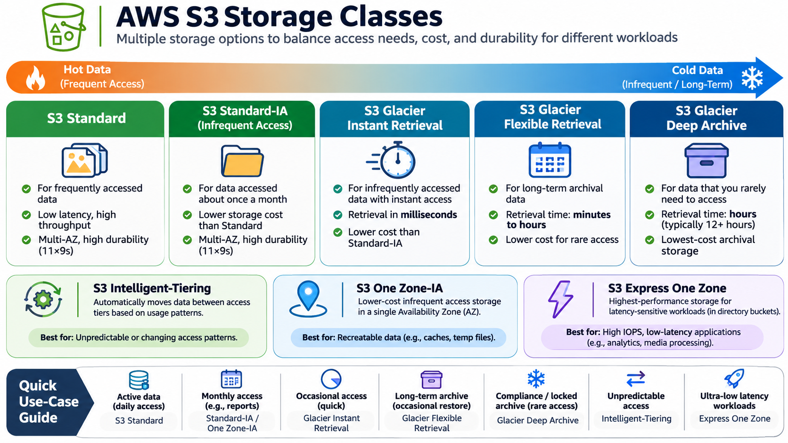

*New teaching infographic. Archival storage does not automatically enforce compliance retention; use S3 Object Lock where appropriate.*

Imagine CompanyABC has daily invoices, monthly reports, audit backups and seven-year records. Keeping everything in Standard is simple but may cost more than necessary. Moving everything to Deep Archive is cheaper for storage but can make urgent recovery impractical.

## 2. Storage classes compared

| Class | AWS CLI value | Access / restore | AZs | Minimum billing duration | Typical workload |
|---|---|---|---|---|---|
| Standard | STANDARD | Milliseconds | 3+ | None | Active application files |
| Intelligent-Tiering | INTELLIGENT_TIERING | Milliseconds in online tiers; optional archive tiers require restore | 3+ | None | Unpredictable access |
| Standard-IA | STANDARD_IA | Milliseconds | 3+ | 30 days | Monthly reports, backups |
| One Zone-IA | ONEZONE_IA | Milliseconds | 1 | 30 days | Re-creatable secondary data |
| Glacier Instant Retrieval | GLACIER_IR | Milliseconds | 3+ | 90 days | Rarely read medical images |
| Glacier Flexible Retrieval | GLACIER | Expedited 1–5 min typically; standard 3–5 h; bulk 5–12 h | 3+ | 90 days | Annual backup recovery |
| Glacier Deep Archive | DEEP_ARCHIVE | Standard within 12 h; bulk within 48 h | 3+ | 180 days | Long-term audit archives |
| Express One Zone | EXPRESS_ONEZONE | Single-digit milliseconds | 1 | None | High-performance analytics; directory bucket |

All listed classes are designed for 99.999999999% object durability; single-AZ classes are not resilient to loss of that AZ. Availability is different from durability (availability is whether a request can be served; durability is whether data survives). Standard is designed for 99.99% availability, Standard-IA and Glacier Instant 99.9%, One Zone-IA 99.5%, Express 99.95%. Flexible and Deep Archive require restoration before ordinary reads. See AWS documentation for current design targets and region availability.

### 2.1 Standard — everyday files
Use for daily reads and writes: website content, active orders, application uploads. No minimum storage duration or retrieval fee, but requests and transfer may cost money. Default for general purpose uploads unless configured otherwise.

### 2.2 Intelligent-Tiering — uncertain demand
Objects at least 128 KB are monitored and move to Infrequent Access after 30 consecutive days without access and Archive Instant Access after 90 days. Optional Archive Access (90+ days) and Deep Archive Access (180+ days) require restore. Small objects remain in Frequent Access without monitoring charges. Monitoring fees apply to eligible objects; no retrieval fees within Intelligent-Tiering, but other request charges may apply.

### 2.3 Standard-IA — rare but urgent
Use for monthly reports or disaster recovery copies that must open immediately. Lower storage rate than Standard, but per-GB retrieval charges and minimum 30-day billing; minimum billable size 128 KB.

### 2.4 One Zone-IA — replaceable files
Use for derived exports that can be rebuilt from authoritative data. Similar access to Standard-IA, but a single AZ; do not use as the only copy of critical records. 30-day and 128 KB minimums apply.

### 2.5 Glacier Instant Retrieval — cold but immediately available
Use for infrequently opened scans or historical media. No restore request is needed. Retrieval charges, 90-day minimum and 128 KB minimum billable size apply.

### 2.6 Glacier Flexible Retrieval — restore before reading
Use when recovery can wait minutes or hours. Initiate restore, wait for completion, then read a temporary accessible copy. Expedited capacity can be limited; standard and bulk options are slower. 90-day minimum applies; archive metadata overhead and restore costs may apply.

### 2.7 Glacier Deep Archive — long retention
Use for audit material or compliance records with long recovery tolerance. Restore before reading; 180-day minimum applies. Retention enforcement is separate from class selection.

### 2.8 Express One Zone — performance-specialized
Use a directory bucket in a supported AZ for latency-sensitive processing. It is not an archival tier or a normal lifecycle destination from a general purpose bucket. Review its distinct endpoints, authentication and feature support.

## 3. Real-world design: CompanyABC

| Object prefix | Access pattern | Class choice | Why |
|---|---|---|---|
| orders/current/ | Multiple times daily | Standard | Immediate active processing |
| reports/monthly/ | Occasional | Standard-IA | Immediate recovery |
| media/history/ | Unpredictable | Intelligent-Tiering | Automatic optimization |
| derived/ | Re-creatable | One Zone-IA | Accepts single-AZ risk |
| medical/ | Rare, urgent | Glacier Instant | Immediate read |
| backup/ | Rare, hours acceptable | Glacier Flexible | Archive economics |
| audit/ | Years, hours acceptable | Deep Archive | Long retention |

### Cost planning
Compare total cost = storage + requests + retrieval/restore + transfer + monitoring + early-deletion charges (where applicable). IA and Glacier Instant have 128 KB minimum billable size. Flexible and Deep Archive have additional per-object metadata overhead. Deleting or transitioning before minimum duration can incur remaining-duration charges. Use Mumbai (ap-south-1) pricing rather than assuming a universal price. See [S3 pricing](https://aws.amazon.com/s3/pricing/).

## 4. Hands-on: upload and inspect storage classes

Prerequisites: AWS console or CLI v2, a sandbox account, permission to create/read objects and configure lifecycle. Use IAM Identity Center, a role or an approved CLI profile; do not share access keys. Replace every example bucket name and account ID with real lab values. Choose Asia Pacific (Mumbai), ap-south-1, and keep Block Public Access enabled.

1. S3 → General purpose buckets → Create bucket. Enter a globally unique name and choose Mumbai. Keep Bucket owner enforced and default encryption enabled.
2. Open the bucket → Upload → Add files → select a harmless test file.
3. Expand Properties, choose Standard under Storage class, then Upload.
4. Repeat for Standard-IA or Intelligent-Tiering using different object keys. Open the object details and inspect Storage class.
5. To change an existing object's class, use Actions → Edit storage class if available; this performs a copy/rewrite. Check versioning and cost impacts.

PowerShell (change profile name and bucket):

```powershell
$B = 'companyabc-s3-lab-unique'
$P = 'TrainingLab'
Set-Content sample.txt 'S3 storage class demo'
aws sts get-caller-identity --profile $P
aws s3 cp sample.txt "s3://$B/demo/standard.txt" --storage-class STANDARD --region ap-south-1 --profile $P
aws s3 cp sample.txt "s3://$B/demo/ia.txt" --storage-class STANDARD_IA --region ap-south-1 --profile $P
aws s3api head-object --bucket $B --key demo/ia.txt --profile $P
aws s3api list-objects-v2 --bucket $B --query 'Contents[].{Key:Key,Class:StorageClass}' --output table --profile $P
```

Bash alternative:

```bash
B=companyabc-s3-lab-unique
P=TrainingLab
printf 'S3 demo\n' > sample.txt
aws s3 cp sample.txt "s3://$B/demo/standard.txt" --storage-class STANDARD --region ap-south-1 --profile "$P"
aws s3api head-object --bucket "$B" --key demo/standard.txt --profile "$P"
```

HeadObject may omit StorageClass for Standard; ListObjectsV2 displays it. These commands operate on an existing bucket. Tiny lab files may cost more per byte in IA due to minimum size.

## 5. Lifecycle rules: automate transitions

A lifecycle rule selects objects by prefix, tags or size and schedules transitions or expiration. Example: logs enter Standard on day 0 → Standard-IA on day 30 → Glacier Flexible on day 90 → Deep Archive on day 365. The dates are object age, not days after previous transition. The example is intentionally spaced to avoid early transition minimum-duration charges.

```text
Day 0           Day 30           Day 90             Day 365
Standard  --->  Standard-IA ---> Flexible Glacier ---> Deep Archive
```

Console: bucket → Management → Lifecycle rules → Create lifecycle rule → name it logs-archive → limit scope to prefix logs/ → select Transition current versions → add the three transitions → review and create. Use objects larger than 128 KB for this demo; by default modern lifecycle configurations do not transition smaller objects unless configured appropriately. Rules run asynchronously, not exactly at midnight or immediately. Versioned buckets need separate noncurrent-version rules and delete-marker handling.

```json
{
  "Rules": [{
    "ID": "logs-archive",
    "Status": "Enabled",
    "Filter": {"Prefix": "logs/"},
    "Transitions": [
      {"Days": 30, "StorageClass": "STANDARD_IA"},
      {"Days": 90, "StorageClass": "GLACIER"},
      {"Days": 365, "StorageClass": "DEEP_ARCHIVE"}
    ]
  }]
}
```

Save as lifecycle.json. `aws s3api put-bucket-lifecycle-configuration --bucket $B --lifecycle-configuration file://lifecycle.json --profile $P` replaces the existing lifecycle configuration. Back it up first using get-bucket-lifecycle-configuration. Expiration deletes data; do not enable it on real records without retention approval.

### Restore an archived object
Console: Objects → select archived object → Actions → Initiate restore → choose retrieval tier and restoration duration. Check status before downloading. For a Flexible Retrieval object:

```powershell
aws s3api restore-object --bucket $B --key backup/annual.zip --restore-request '{"Days":1,"GlacierJobParameters":{"Tier":"Standard"}}' --profile $P
aws s3api head-object --bucket $B --key backup/annual.zip --profile $P
```

Use file://restore.json if your PowerShell version mishandles inline JSON quoting. Restore status shows ongoing-request until ready. The archived original stays in its class; copy the restored object to Standard if you need permanent online access. Deep Archive does not support expedited retrieval.

## 6. Bucket policy — introduction

The following images are from the supplied Bucket Policy PPT. They are preserved as teaching visuals; incomplete JSON in earlier slides is not executable. The corrected examples below use proper ARNs, principals and JSON syntax.

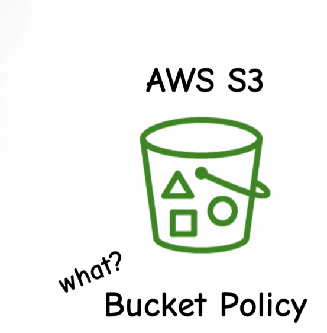

*Original PPT, slide 2: What is an S3 bucket policy?.*
A bucket policy is a resource-based JSON policy attached to an S3 bucket. It describes which principals may perform which operations on the bucket or object keys, optionally under specific conditions. It is not a network firewall or EC2 security group.

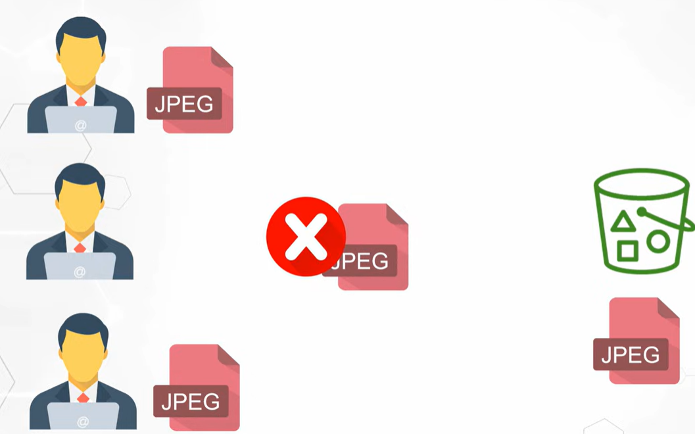

*Original PPT, slide 3: A request to access an image is rejected.*
A request without an applicable Allow is implicitly denied. An explicit Deny overrides an otherwise applicable Allow. A failed read does not mean the object was deleted.

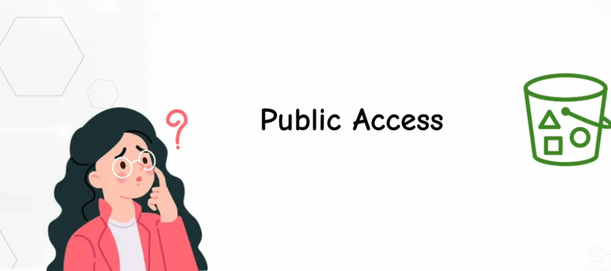

*Original PPT, slide 4: Should this bucket allow public access?.*

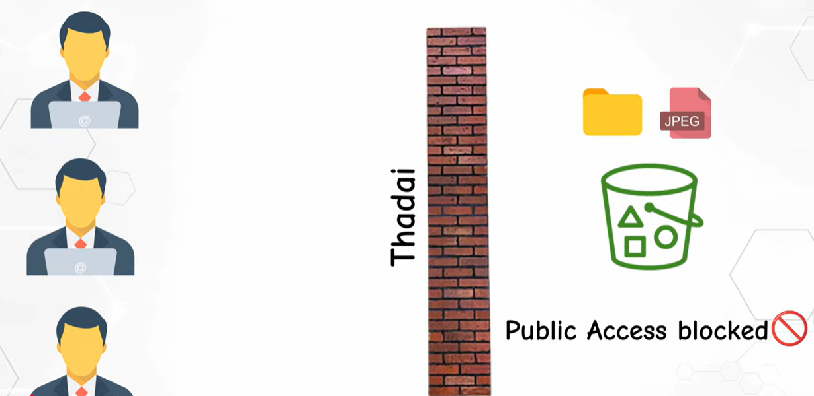

*Original PPT, slide 5: Block Public Access acts as a protective barrier.*
New general purpose buckets normally block public access. Keep this setting enabled for private corporate data. The brick wall is an analogy: authorized private requests can still succeed. Block Public Access has four settings that block or ignore public ACLs and block or restrict public bucket policies; the most restrictive applicable account/bucket settings win.

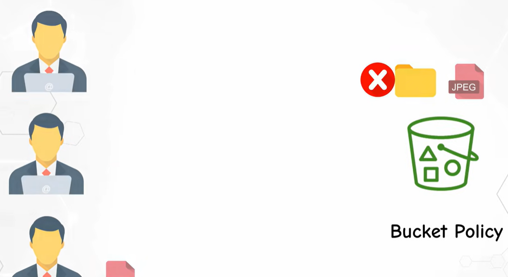

*Original PPT, slide 6: Bucket policy controls access to objects.*

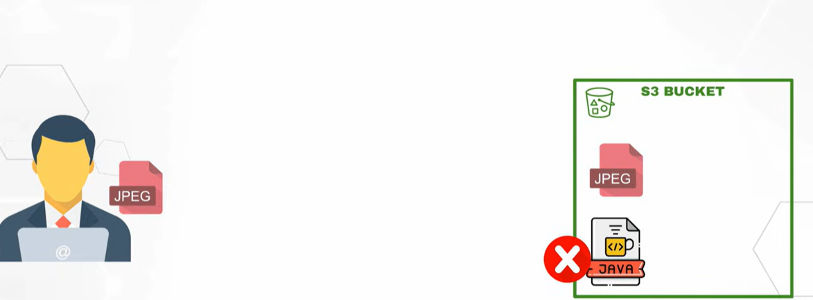

*Original PPT, slide 7: Selective access to JPEG versus Java keys.*
A policy can match key prefixes or suffixes such as images/*.jpg. It cannot validate file contents or MIME type by filename alone. Use application-side validation for actual file type. A narrow Allow is not an absolute restriction if other policies grant access.

## 7. JSON policy anatomy

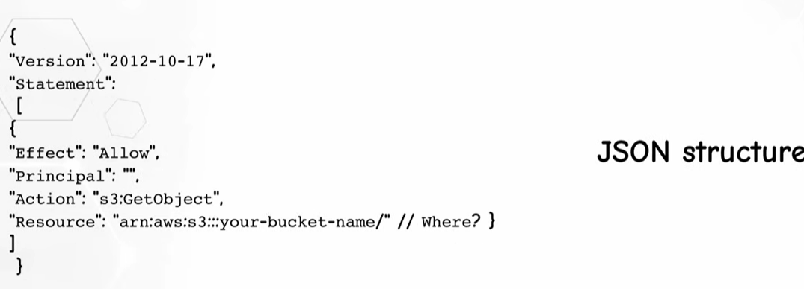

*Original PPT, slide 8: Illustrative JSON structure — corrected below.*


*Original PPT, slide 9: Four core pieces of a policy rule.*

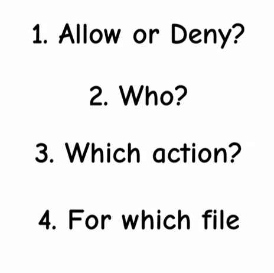

*Original PPT, slide 10: Four questions to answer.*

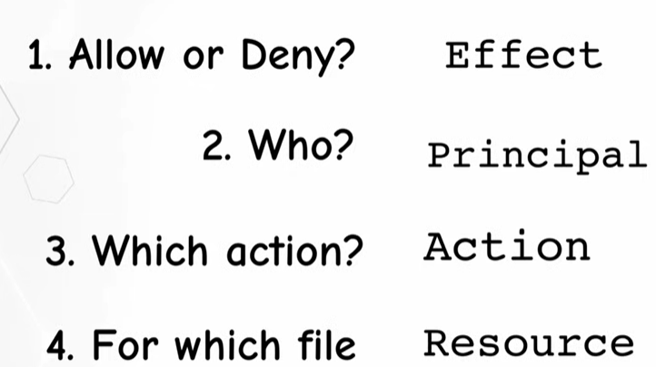

*Original PPT, slide 11: Mapping questions to JSON fields.*
| Field | Question | Example |
|---|---|---|
| Version | Which policy language? | 2012-10-17 |
| Statement | Which rules? | Array of statements |
| Sid | Optional rule label? | ReaderAccess |
| Effect | Allow or Deny? | Allow |
| Principal | Who? | IAM role ARN |
| Action | What operation? | s3:GetObject |
| Resource | On which resource? | arn:aws:s3:::bucket/images/* |
| Condition | Under what circumstances? | aws:SourceIp |

### 7.1 Effect

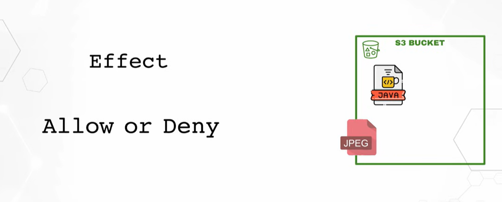

*Original PPT, slide 12: Effect: Allow or Deny.*
Explicit Deny wins. Default is implicit Deny. In a same-account request, an applicable identity or resource Allow can generally grant access, subject to applicable boundaries, session policies, SCPs and explicit denies. Cross-account requests normally require permission on both sides.

### 7.2 Principal

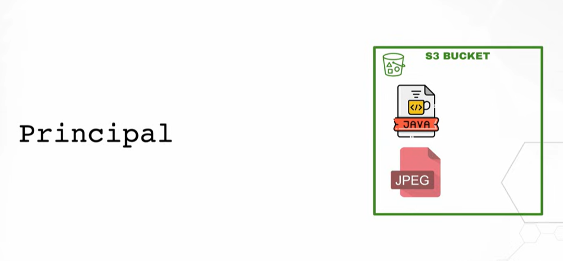

*Original PPT, slide 14: Principal: the identity requesting access.*
Use an existing IAM role ARN for application access. An IAM user ARN is also possible; an IAM group cannot be a Principal. Principal "*" matches everyone, including anonymous requests where supported. Avoid broad Allow unless intentionally publishing data.

### 7.3 Action

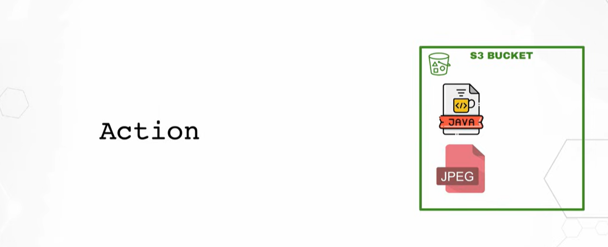

*Original PPT, slide 15: Action: which operation?.*

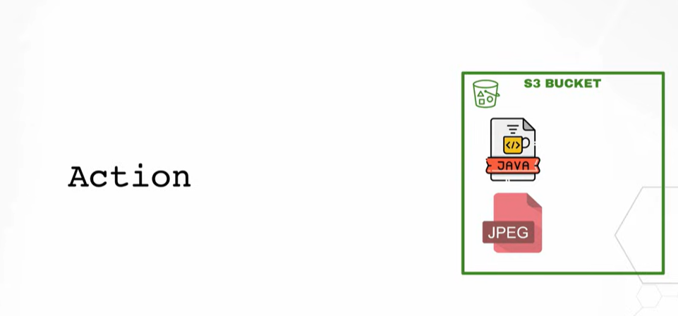

*Original PPT, slide 16: Actions apply to selected resources.*

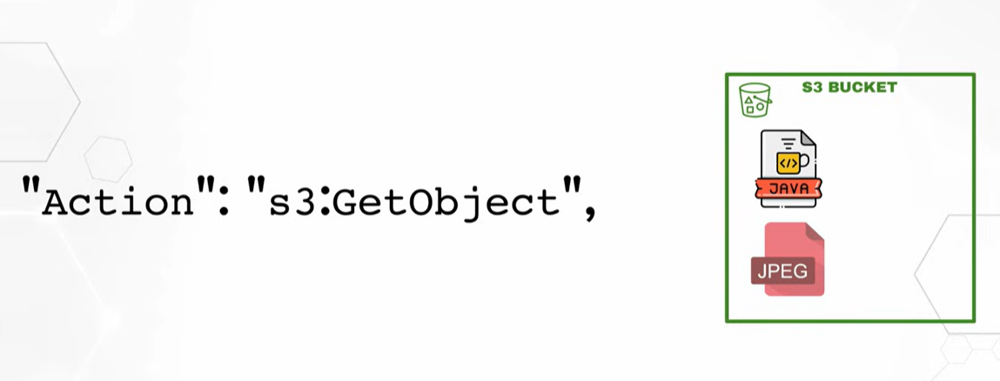

*Original PPT, slide 17: GetObject is the read operation.*
| Action | Meaning | Resource |
|---|---|---|
| s3:ListBucket | List keys | Bucket ARN |
| s3:GetObject | Download object | Object ARN |
| s3:PutObject | Upload or replace | Object ARN |
| s3:DeleteObject | Delete object | Object ARN |
| s3:GetObjectVersion | Read specific version | Object ARN |
| s3:PutBucketPolicy | Modify policy | Bucket ARN |

### 7.4 Resource

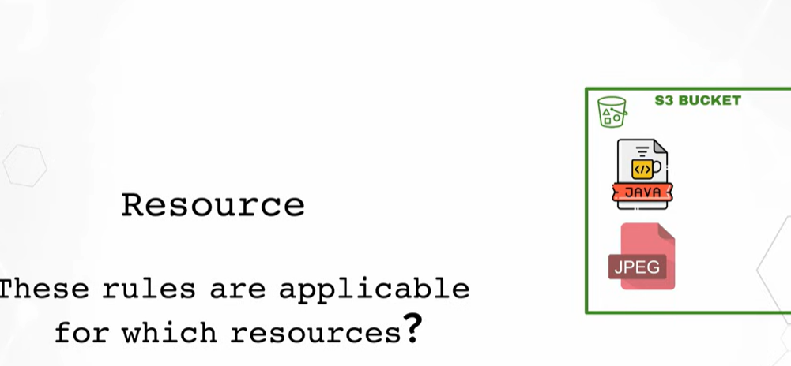

*Original PPT, slide 18: Resource identifies what the rule covers.*

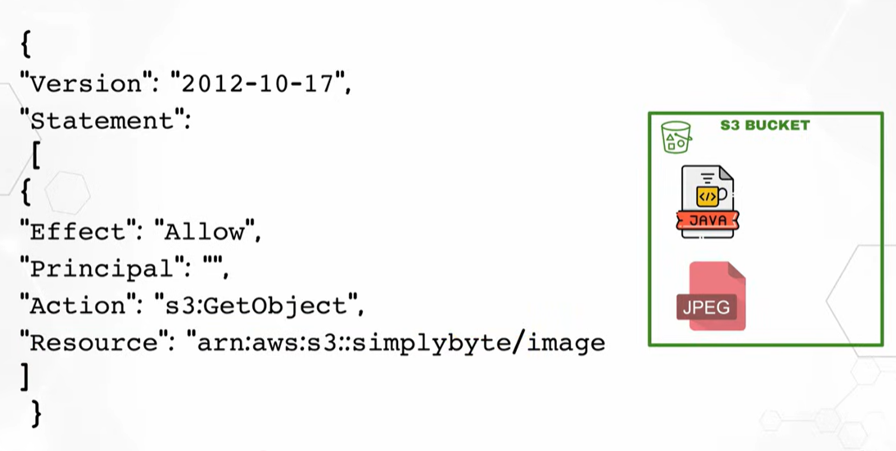

*Original PPT, slide 19: Illustrative object ARN — use valid full syntax below.*
Bucket ARN: `arn:aws:s3:::companyabc-s3-lab-unique` (no trailing slash). All objects: `arn:aws:s3:::companyabc-s3-lab-unique/*`. Single object: `arn:aws:s3:::companyabc-s3-lab-unique/images/logo.jpg`. Prefix: `arn:aws:s3:::companyabc-s3-lab-unique/images/*`. S3 folders are key prefixes. Keys are case-sensitive.

## 8. Console walkthrough: configure a policy

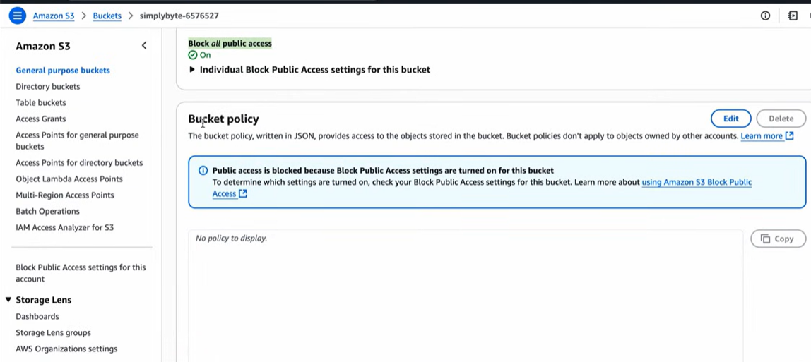

*Original PPT, slide 20: Permissions tab: Block Public Access and Bucket policy.*
1. Open S3 → select your sandbox bucket → Permissions.
2. Verify Block all public access is On. Under Bucket policy choose Edit. You need s3:GetBucketPolicy and s3:PutBucketPolicy permissions as appropriate.

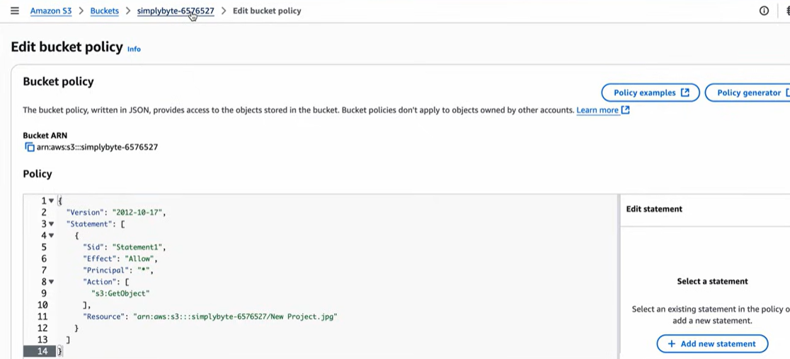

*Original PPT, slide 21: Edit bucket policy: paste and review JSON.*
3. Paste the role-based policy from example 1 below, after replacing the bucket and role ARN. Review validation and security findings. Save changes.

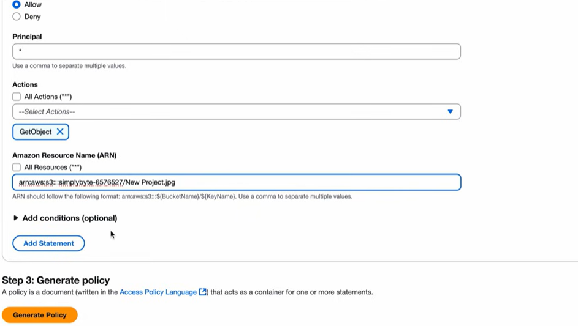

*Original PPT, slide 22: Policy generator: Effect, Principal, Action, ARN and optional conditions.*
4. Alternatively use the policy generator shown in the deck if available: select S3 bucket policy, effect, principal, action and resource, add statement, generate, then copy JSON into the editor. Prefer a named role instead of the wildcard shown here.
5. Test using the intended role/profile and another identity. Save a copy of the previous policy before any change. A bucket has one bucket policy document; combine approved statements instead of overwriting production rules.

## 9. Runnable JSON scenarios

Each JSON file is standalone and uses example placeholders. Replace them before applying. Test one scenario at a time in a disposable bucket; combine only after reviewing the combined effects. Use existing IAM roles with appropriate trust policies and test profiles. Keep public access blocked except the explicitly optional public lab.

### Example 1 — named role reads a single image

```json
{
  "Version": "2012-10-17",
  "Statement": [
    {
      "Sid": "ReadOneImage",
      "Effect": "Allow",
      "Principal": {
        "AWS": "arn:aws:iam::111122223333:role/S3LabReader"
      },
      "Action": "s3:GetObject",
      "Resource": "arn:aws:s3:::companyabc-s3-lab-unique/images/logo.jpg"
    }
  ]
}
```
Only grants the named role the ability to read this key. It does not grant list, write or delete. Other permissions can still apply. A signed request is required. For a temporary external share, prefer a presigned URL rather than public access.

### Example 2 — developers upload, testers read

```json
{
  "Version": "2012-10-17",
  "Statement": [
    {
      "Sid": "DeveloperUpload",
      "Effect": "Allow",
      "Principal": {
        "AWS": "arn:aws:iam::111122223333:role/DeveloperRole"
      },
      "Action": [
        "s3:GetObject",
        "s3:PutObject"
      ],
      "Resource": "arn:aws:s3:::companyabc-s3-lab-unique/project/*"
    },
    {
      "Sid": "TesterRead",
      "Effect": "Allow",
      "Principal": {
        "AWS": "arn:aws:iam::111122223333:role/TesterRole"
      },
      "Action": "s3:GetObject",
      "Resource": "arn:aws:s3:::companyabc-s3-lab-unique/project/*"
    },
    {
      "Sid": "ListProject",
      "Effect": "Allow",
      "Principal": {
        "AWS": [
          "arn:aws:iam::111122223333:role/DeveloperRole",
          "arn:aws:iam::111122223333:role/TesterRole"
        ]
      },
      "Action": "s3:ListBucket",
      "Resource": "arn:aws:s3:::companyabc-s3-lab-unique",
      "Condition": {
        "StringLike": {
          "s3:prefix": [
            "project/",
            "project/*"
          ]
        }
      }
    }
  ]
}
```
CompanyABC developers A/B assume DeveloperRole; testers C/D assume TesterRole. Both can list with prefix project/ and read. Developers can write. Testers have no write grant here; ensure their identity policies do not separately grant it, or add an explicit Deny for the tester role if required. Console browsing of the root may fail by design; use CLI prefix listing.

### Example 3 — allow a role to read from one office public IP

```json
{
  "Version": "2012-10-17",
  "Statement": [
    {
      "Sid": "OfficeReader",
      "Effect": "Allow",
      "Principal": {
        "AWS": "arn:aws:iam::111122223333:role/S3LabReader"
      },
      "Action": "s3:GetObject",
      "Resource": "arn:aws:s3:::companyabc-s3-lab-unique/reports/*",
      "Condition": {
        "IpAddress": {
          "aws:SourceIp": "203.0.113.10/32"
        }
      }
    }
  ]
}
```
203.0.113.10 is a documentation-only address. Replace with your actual office internet egress IP; /32 means one IPv4 address, /24 means a 256-address range. For one IPv6 address use /128. This grant applies only when the IP matches, but another unconditional Allow may still authorize outside access. Use Example 4 for enforcement. Do not use a laptop private address such as 10.0.1.10 for public endpoint requests; S3 sees the public egress address (often NAT/VPN).

### Example 4 — enforce office-only reads even if IAM allows elsewhere

```json
{
  "Version": "2012-10-17",
  "Statement": [
    {
      "Sid": "OfficeReader",
      "Effect": "Allow",
      "Principal": {
        "AWS": "arn:aws:iam::111122223333:role/S3LabReader"
      },
      "Action": "s3:GetObject",
      "Resource": "arn:aws:s3:::companyabc-s3-lab-unique/reports/*",
      "Condition": {
        "IpAddress": {
          "aws:SourceIp": [
            "203.0.113.10/32",
            "198.51.100.0/24"
          ]
        }
      }
    },
    {
      "Sid": "DenyOutsideOffice",
      "Effect": "Deny",
      "Principal": "*",
      "Action": "s3:GetObject",
      "Resource": "arn:aws:s3:::companyabc-s3-lab-unique/reports/*",
      "Condition": {
        "NotIpAddress": {
          "aws:SourceIp": [
            "203.0.113.10/32",
            "198.51.100.0/24"
          ]
        },
        "Bool": {
          "aws:PrincipalIsAWSService": "false"
        }
      }
    }
  ]
}
```
The second statement explicitly denies non-service-principal reads outside the approved networks, even if IAM allows. It does not deny writes or list, nor grant service access. If the IP key is absent (e.g. VPC endpoint), this negated match can deny the request; use a separate endpoint design if needed. Replace both documentation addresses. Test with the same role from office network and a mobile hotspot (verify actual egress). Do not put policy-management actions in this Deny during the lab.

```text
Office IP + authorized role ----> S3 policy ----> reports/ : ALLOW
Hotspot   + same role ----------> S3 policy ----> reports/ : DENY
Office IP + unauthorized role --> S3 policy ----> reports/ : DENY (no other Allow)
```

### Example 5 — require HTTPS

```json
{
  "Version": "2012-10-17",
  "Statement": [
    {
      "Sid": "DenyInsecureTransport",
      "Effect": "Deny",
      "Principal": "*",
      "Action": "s3:*",
      "Resource": [
        "arn:aws:s3:::companyabc-s3-lab-unique",
        "arn:aws:s3:::companyabc-s3-lab-unique/*"
      ],
      "Condition": {
        "Bool": {
          "aws:SecureTransport": "false",
          "aws:PrincipalIsAWSService": "false"
        }
      }
    }
  ]
}
```
This guardrail grants nothing. It denies non-service requests over insecure transport, while HTTPS still needs an Allow. Service-principal exclusion avoids unintended denial when AWS redacts network context. Use normal AWS CLI HTTPS endpoints; do not transmit credentials over HTTP.

### Example 6 — private EC2 access through S3 gateway endpoint

```json
{
  "Version": "2012-10-17",
  "Statement": [
    {
      "Sid": "DenyReadOutsideEndpoint",
      "Effect": "Deny",
      "Principal": "*",
      "Action": "s3:GetObject",
      "Resource": "arn:aws:s3:::companyabc-s3-lab-unique/internal/*",
      "Condition": {
        "StringNotEquals": {
          "aws:SourceVpce": "vpce-0abcdef1234567890"
        }
      }
    }
  ]
}
```
Create a gateway endpoint for com.amazonaws.ap-south-1.s3 in the CompanyABC VPC, associate the route tables of the private subnets, and attach an IAM role to EC2 with GetObject permission. Replace the endpoint ID. The endpoint policy must allow requests too. This denies reads of internal/ from other paths, including console downloads. It grants nothing. Avoid applying a blanket s3:* Deny until recovery is planned. For private source IP restrictions through endpoints use aws:VpcSourceIp with source VPC/endpoint constraints, not aws:SourceIp.

### Example 7 — protect audit records from deletion

```json
{
  "Version": "2012-10-17",
  "Statement": [
    {
      "Sid": "DenyAuditDeletion",
      "Effect": "Deny",
      "Principal": "*",
      "Action": [
        "s3:DeleteObject",
        "s3:DeleteObjectVersion"
      ],
      "Resource": "arn:aws:s3:::companyabc-s3-lab-unique/audit/*"
    }
  ]
}
```
Denies these API delete operations even for administrators unless the policy is changed. Not an immutable retention control: lifecycle actions are not blocked by bucket-policy denies, and authorized administrators may change the policy. For compliance retention use versioning and S3 Object Lock with approved retention configuration. Do not test against real audit data.

### Example 8 — cross-account partner reads approved exports

```json
{
  "Version": "2012-10-17",
  "Statement": [
    {
      "Sid": "PartnerRead",
      "Effect": "Allow",
      "Principal": {
        "AWS": "arn:aws:iam::444455556666:role/PartnerReader"
      },
      "Action": "s3:GetObject",
      "Resource": "arn:aws:s3:::companyabc-s3-lab-unique/exports/*"
    }
  ]
}
```
The partner also needs an identity policy allowing the same action/resource, plus KMS permissions/key policy if SSE-KMS is used. Keep Bucket owner enforced and Block Public Access enabled. A fixed, trusted role is not anonymous public access.

### Example 9 — allow JPEG keys only for an image uploader

```json
{
  "Version": "2012-10-17",
  "Statement": [
    {
      "Sid": "AllowJpeg",
      "Effect": "Allow",
      "Principal": {
        "AWS": "arn:aws:iam::111122223333:role/DeveloperRole"
      },
      "Action": "s3:PutObject",
      "Resource": "arn:aws:s3:::companyabc-s3-lab-unique/images/*.jpg"
    }
  ]
}
```
Grants matching lowercase .jpg keys only; .jpeg and .JPG need additional patterns. This is not file validation and does not override other Allows. Ensure no broad uploads exist or use a carefully scoped explicit Deny if mandatory.

### Example 10 — optional public read of one demo image

```json
{
  "Version": "2012-10-17",
  "Statement": [
    {
      "Sid": "PublicLogo",
      "Effect": "Allow",
      "Principal": "*",
      "Action": "s3:GetObject",
      "Resource": "arn:aws:s3:::companyabc-s3-lab-unique/public/logo.jpg"
    }
  ]
}
```
This mirrors the intent of the original PPT console screenshot. It is intentionally public and may be rejected by Block Public Access. For isolated disposable training only, use a non-sensitive image and obtain approval before changing relevant bucket/account public-policy blocks; do not weaken shared account protections. Restore protection and remove this statement after the demo. Prefer CloudFront with Origin Access Control for public websites backed by private buckets. A presigned URL grants temporary access without making the bucket public.

## 10. Apply and verify policies with AWS CLI

PowerShell, from the extracted tutorial folder:

```powershell
$B = 'companyabc-s3-lab-unique'
$P = 'TrainingLab'
aws s3api get-bucket-policy --bucket $B --profile $P --query Policy --output text > previous-policy.json
aws s3api put-bucket-policy --bucket $B --policy file://policies/02-dev-test.json --profile $P
aws s3api get-bucket-policy --bucket $B --profile $P --query Policy --output text
aws s3api get-public-access-block --bucket $B --profile $P
aws s3api get-bucket-policy-status --bucket $B --profile $P
```

If no previous policy exists, get-bucket-policy returns NoSuchBucketPolicy; record that rather than restoring an empty backup. The put command replaces the document; edit the example file first. Use distinct profiles or assumed roles for tests; verify each identity with sts get-caller-identity.

```powershell
aws s3 cp sample.txt "s3://$B/project/sample.txt" --profile DevLab
aws s3 ls "s3://$B/project/" --profile TesterLab
aws s3 cp "s3://$B/project/sample.txt" downloaded.txt --profile TesterLab
aws s3 cp sample.txt "s3://$B/project/blocked.txt" --profile TesterLab
```

Expected: developer upload, tester list and download succeed; tester upload fails if no independent write grant exists. For the IP lab use `aws s3api get-object --bucket $B --key reports/sample.txt downloaded.txt --profile ReaderLab` from both networks. Seed the test object first. Test access using an actual request, not just a console policy preview.

| Test | Expected (assuming no other grants/denies) |
|---|---|
| Developer upload project/ | Success |
| Tester download project/ | Success |
| Tester upload project/ | AccessDenied |
| Reader matching approved IP | Success |
| Reader outside IP with explicit Deny | AccessDenied |
| Anonymous private object URL | 403 or other denial |
| Read archived Flexible object before restore | InvalidObjectState if authorized |

## 11. Troubleshooting and security checklist

| Symptom | Check |
|---|---|
| AccessDenied | Caller identity, action, exact key, explicit Deny, SCP, boundary, session policy, endpoint policy, KMS access |
| Invalid principal | Role exists, correct account and ARN; role may have been recreated |
| Action does not apply to resource | ListBucket needs bucket ARN; object actions need object ARN |
| Public policy rejected | Account/bucket Block Public Access; do not disable for private access |
| IP rule not working | Actual public egress, VPN/NAT, IPv6, endpoint context; Allow vs explicit Deny |
| Console cannot list | ListBucket and prefix condition; CLI exact key may still work |
| InvalidObjectState | Restore archived object and wait |
| Lifecycle not immediate | Rule filter, object age, size, asynchronous processing |

SSE-S3 is default for new uploads. SSE-KMS requires relevant KMS permissions, and cross-account access typically requires a customer managed key. Use IAM Access Analyzer to validate policies and review external access; enable CloudTrail S3 data events selectively for object-level audit (charges apply). AWS Organizations SCPs restrict maximum permissions, not grant them.

Cleanup: restore the approved prior policy (or delete the lab policy only if none existed), turn Block Public Access back on if altered, remove lab lifecycle configuration if appropriate, delete test objects and versions, then delete the sandbox bucket. Check charges and retention first; archived items may incur early deletion charges. Never run destructive cleanup on production buckets.

## 12. Practice assignment and interview review

**Scenario:** CompanyABC wants private storage for developers, testers and audit staff. Build a sandbox bucket with project/, reports/, audit/ and logs/ prefixes. Choose a storage class for each, create a lifecycle rule for logs, implement developer/tester access, office-only reports and HTTPS enforcement. Test positive and negative cases. Submit policy JSON, screenshots of successful/denied operations and a short cost explanation.

| Question | Answer |
|---|---|
| Can objects in one bucket use different storage classes? | Yes, in a general purpose bucket. |
| Which class handles unpredictable access? | Intelligent-Tiering. |
| Which archive class reads immediately? | Glacier Instant Retrieval. |
| Can Standard-IA incur early deletion charges? | Yes, before 30 days. |
| Does a storage class grant permissions? | No. |
| What wins over an Allow? | Applicable explicit Deny. |
| Why not use bucket ARN for GetObject? | GetObject acts on object resources. |
| Is an IP-based Allow sufficient to block all other IPs? | No, other Allows may exist. |
| Does public access block all IAM users? | No, it targets public access. |
| How to privately reach S3 from EC2? | Use an S3 VPC endpoint with appropriate permissions. |
| Does a .jpg key prove the data is JPEG? | No, validate actual content separately. |
| Is Glacier Deep Archive equivalent to Object Lock? | No, archive class is not retention enforcement. |

## 13. Official references

- [Storage class comparison](https://docs.aws.amazon.com/AmazonS3/latest/userguide/storage-class-intro.html)
- [S3 pricing](https://aws.amazon.com/s3/pricing/)
- [Lifecycle transitions](https://docs.aws.amazon.com/AmazonS3/latest/userguide/lifecycle-transition-general-considerations.html)
- [Restoring archived objects](https://docs.aws.amazon.com/AmazonS3/latest/userguide/restoring-objects.html)
- [Bucket policy examples](https://docs.aws.amazon.com/AmazonS3/latest/userguide/example-bucket-policies.html)
- [Policy condition keys](https://docs.aws.amazon.com/AmazonS3/latest/userguide/amazon-s3-policy-keys.html)
- [Block Public Access](https://docs.aws.amazon.com/AmazonS3/latest/userguide/access-control-block-public-access.html)
- [VPC endpoint policies](https://docs.aws.amazon.com/AmazonS3/latest/userguide/example-bucket-policies-vpc-endpoint.html)
- [IAM evaluation logic](https://docs.aws.amazon.com/IAM/latest/UserGuide/reference_policies_evaluation-logic.html)

Source illustrations: supplied s3 Buckect policy.pptx, all 20 image-bearing slides (2–12 and 14–22). Storage class infographic and expanded examples are new teaching material.
