# AWS S3 – Complete Step-by-Step Tutorial

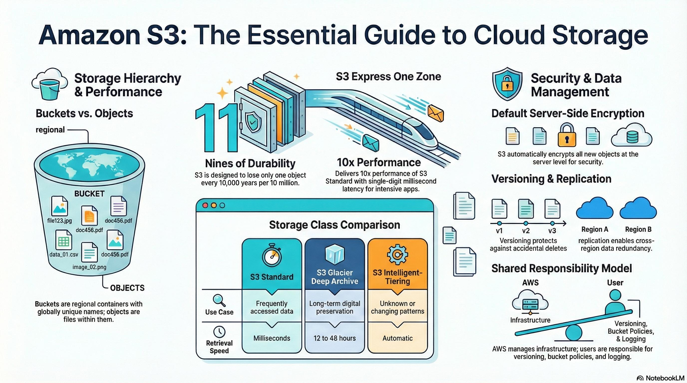
## 2. Why S3?

**Scenario:** TechGenie Solutions has four employees: Sanjay and Mukul (developers), Priya and Rahul (testers). Initially, they store shared files on a Windows EC2 server. This creates dependencies on the server's availability, attached storage capacity, backups, and operating-system file-sharing permissions. Amazon S3 provides scalable object storage independent of that EC2 server.

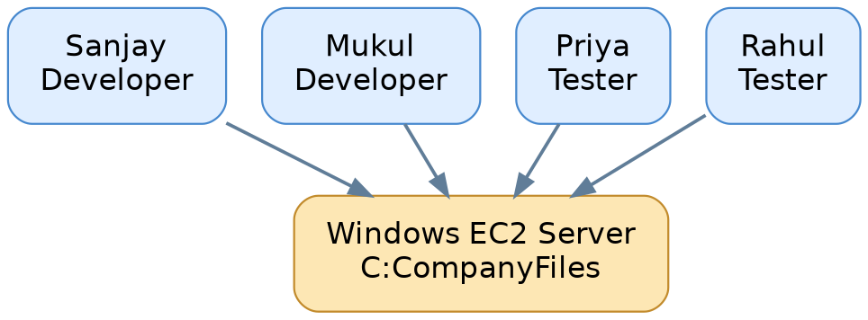


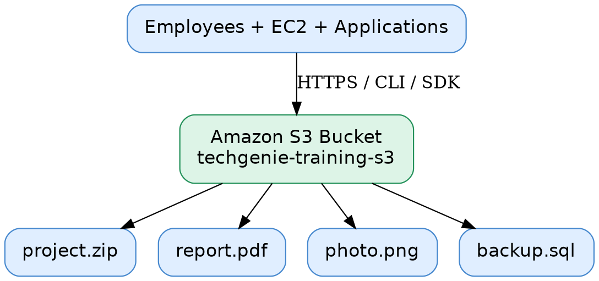


## 3. What is Amazon S3?

Amazon Simple Storage Service (S3) is AWS object storage for files, images, videos, documents, logs, backups, and data lakes.

| Term | Meaning | Example |
|---|---|---|
| Bucket | Container for objects | `techgenie-training-s3` |
| Object | Stored data plus metadata | `employees.csv` |
| Key | Complete object name | `reports/2026/report.pdf` |
| Region | AWS location of bucket | `ap-south-1` |
| Versioning | Retains object versions | Version 1, Version 2 |
| IAM | Identity-based permissions | Read-only access |
| Bucket policy | Resource-based permissions | Specific role access |
| Storage class | Storage tier | S3 Standard |

**Note:** S3 is object storage, not a Windows drive or POSIX filesystem. Most visible folders are key prefixes.

## 4. S3 vs EBS vs EFS

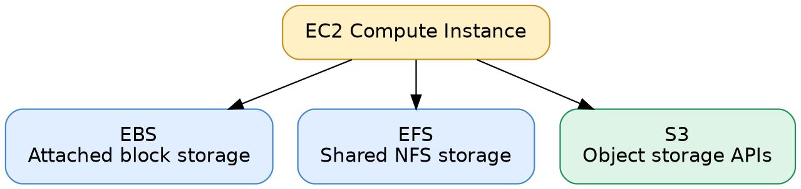


| Feature | S3 | EBS | EFS |
|---|---|---|---|
| Storage | Object | Block | Shared file |
| Access | API / CLI / SDK | Attached EC2 volume | NFS mount |
| Typical use | Backups, data lakes | OS disks, databases | Shared application files |
| EC2 required | No | Usually | No, though often used with compute |
| File system | Not native | NTFS / ext4 possible | NFS |

**Example:** EBS for Windows `C:` drive, S3 for backup ZIPs, EFS for shared Linux files.

# Part 1 – AWS S3 Console

## 5. Lab prerequisites

| Setting | Value |
|---|---|
| Region | Asia Pacific (Mumbai) |
| Region code | `ap-south-1` |
| CLI profile | `BirlaSoft` |
| Example bucket | `techgenie-s3-lab-unique12345` |
| Windows directory | `C:\S3Training` |
| Linux directory | `~/s3-training` |
| Access | Private |
| Encryption | SSE-S3 |

Use an account with appropriate permissions. Charges may apply.

## 6. Lab 1 – Create a bucket in the Console

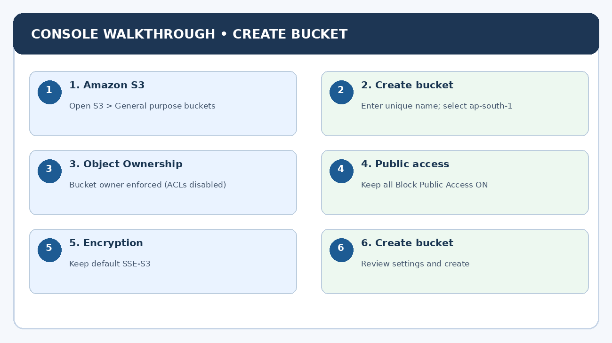


1. Open https://console.aws.amazon.com/s3/ and sign in.
2. Open **S3 → General purpose buckets → Create bucket**.
3. Set **Bucket type:** General purpose.
4. Enter a **globally unique bucket name** (example `techgenie-s3-lab-unique12345`).
5. Choose **AWS Region:** Asia Pacific (Mumbai), `ap-south-1`.
6. Choose **Object Ownership:** Bucket owner enforced (ACLs disabled).
7. Keep **Block all public access** enabled.
8. Keep **Versioning** disabled for the initial lab.
9. Select **SSE-S3** encryption.
10. Leave **Object Lock** disabled and click **Create bucket**.

**Why?** Private access and bucket-owner-enforced ownership are sensible defaults. A bucket's name and Region cannot be changed after creation.

## 7. Lab 2 – Upload your first object

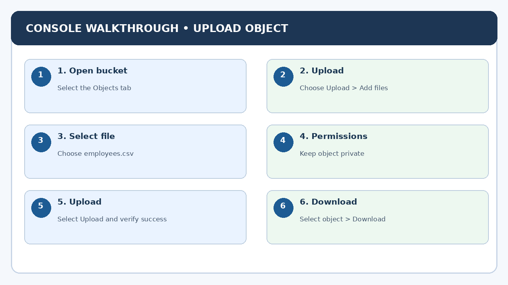


Create `employees.csv`:

```csv
EmployeeID,Name,Department
101,Sanjay,Development
102,Mukul,Development
103,Priya,Testing
104,Rahul,Testing
```

1. Open the bucket and **Objects** tab.
2. Choose **Upload → Add files**.
3. Select `employees.csv` and choose **Upload**.
4. Confirm it appears in the object list.

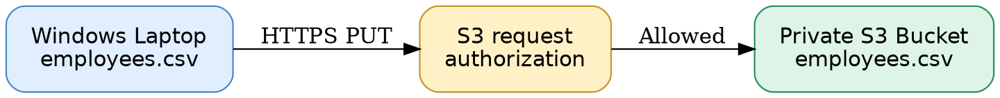

<details>
<summary>Editable Mermaid source for this diagram</summary>

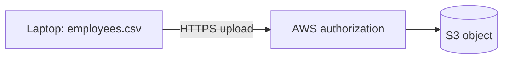

</details>

## 8. Lab 3 – Organize files using prefixes

1. Choose **Create folder**, enter `development`, and save.
2. Repeat for `testing` and `backups`.
3. Upload `employees.csv` under `development/`.
4. Upload `test-report.txt` under `testing/`.

```text
techgenie-s3-lab-unique12345/
├── employees.csv
├── development/
│   └── employees.csv
├── testing/
│   └── test-report.txt
└── backups/
```

An object key such as `development/employees.csv` is one complete key; folders generally represent prefixes.

## 9. Lab 4 – Download and delete

- **Download:** Open bucket → select `employees.csv` → **Download**.
- **Delete:** Select `test-report.txt` → **Delete** → confirm.
- With versioning disabled, deletion generally removes the object permanently. With versioning enabled, ordinary deletion adds a delete marker.

# Part 2 – Windows PowerShell AWS CLI

## 10. Verify CLI identity

```powershell
aws sts get-caller-identity --profile BirlaSoft
aws configure get region --profile BirlaSoft
aws s3 ls --profile BirlaSoft
```

The expected Region is `ap-south-1`. Listing all buckets requires `s3:ListAllMyBuckets`; inability to list all buckets does not necessarily prevent access to a specific bucket.

## 11. Lab 5 – Create a bucket with CLI

```powershell
aws s3api create-bucket --bucket techgenie-s3-lab-unique12345 --region ap-south-1 --create-bucket-configuration LocationConstraint=ap-south-1 --profile BirlaSoft
```

| Parameter | Purpose |
|---|---|
| `s3api` | Low-level S3 API commands |
| `create-bucket` | Create bucket |
| `--bucket` | Name |
| `--region` | AWS Region |
| `LocationConstraint` | Target Region |
| `--profile` | Named credentials/profile |

Skip creation if the bucket already exists.

```powershell
aws s3api head-bucket --bucket techgenie-s3-lab-unique12345 --profile BirlaSoft
aws s3api get-bucket-location --bucket techgenie-s3-lab-unique12345 --profile BirlaSoft
```

`head-bucket` usually returns no text on success.

## 12. Lab 6 – Upload and download

```powershell
New-Item -ItemType Directory -Path C:\S3Training -Force
"Welcome to AWS S3 Training" | Set-Content C:\S3Training\welcome.txt
aws s3 cp C:\S3Training\welcome.txt s3://techgenie-s3-lab-unique12345/welcome.txt --profile BirlaSoft
aws s3 ls s3://techgenie-s3-lab-unique12345/ --profile BirlaSoft
aws s3 cp s3://techgenie-s3-lab-unique12345/welcome.txt C:\S3Training\downloaded-welcome.txt --profile BirlaSoft
Get-Content C:\S3Training\downloaded-welcome.txt
```

Expected output: `Welcome to AWS S3 Training`.

## 13. Lab 7 – Upload a directory

```powershell
"Employee training report" | Set-Content C:\S3Training\report.txt
aws s3 cp C:\S3Training s3://techgenie-s3-lab-unique12345/training/ --recursive --profile BirlaSoft
aws s3 ls s3://techgenie-s3-lab-unique12345/training/ --recursive --profile BirlaSoft
```

`--recursive` includes files under the source directory and its subdirectories.

## 14. Lab 8 – Synchronize

```powershell
aws s3 sync C:\S3Training s3://techgenie-s3-lab-unique12345/backups/ --profile BirlaSoft
aws s3 sync C:\S3Training s3://techgenie-s3-lab-unique12345/backups/ --dryrun --profile BirlaSoft
```

`sync` compares source and destination and transfers missing/changed files. `--dryrun` previews operations. Use `--delete` cautiously: it can remove destination objects not present in the source.

| Command | Meaning |
|---|---|
| `aws s3 cp` | Copy |
| `aws s3 sync` | Synchronize |
| `aws s3 mv` | Move (generally copy then delete) |
| `aws s3 rm` | Remove objects |
| `aws s3 ls` | List |

# Part 3 – Linux CLI

## 15. Lab 9 – Ubuntu access

Verify CLI:

```bash
aws --version
```

Install AWS CLI v2 if missing: https://docs.aws.amazon.com/cli/latest/userguide/getting-started-install.html

**EC2 with an attached IAM role:**

```bash
aws sts get-caller-identity
```

**Organization-approved SSO for a non-EC2 VM:**

```bash
aws configure sso --profile CompanySSO
aws sso login --profile CompanySSO
```

Create and transfer files:

```bash
mkdir -p ~/s3-training
echo "Linux to AWS S3" > ~/s3-training/linux-demo.txt
aws s3 cp ~/s3-training/linux-demo.txt s3://techgenie-s3-lab-unique12345/linux/
aws s3 cp s3://techgenie-s3-lab-unique12345/linux/linux-demo.txt ~/s3-training/downloaded.txt
cat ~/s3-training/downloaded.txt
```

These commands assume default role/credentials; add `--profile CompanySSO` if using that SSO profile. A normal on-premises VM does not automatically receive EC2 role credentials.

# Part 4 – IAM and S3 security

## 16. Security scenario

Developers should upload/download under `development/`; testers should read development files and upload test reports under `testing/`. The bucket must remain private.

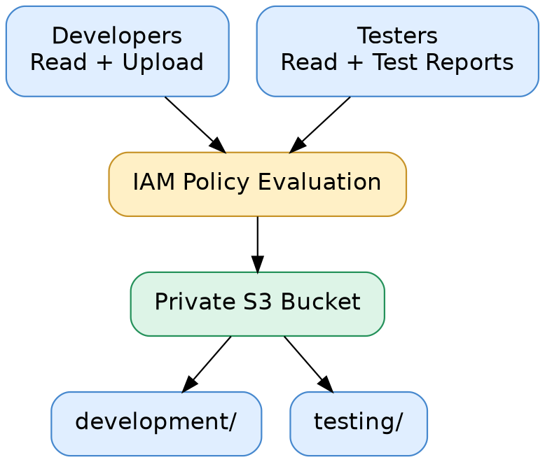

<details>
<summary>Editable Mermaid source for this diagram</summary>

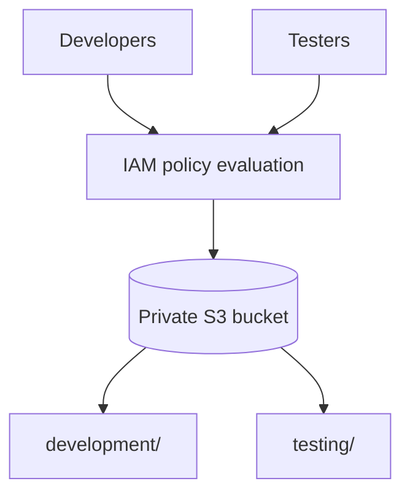

</details>

## 17. Lab 10 – Read-only IAM policy

IAM → Policies → Create policy → JSON:

```json
{
  "Version": "2012-10-17",
  "Statement": [
    {
      "Sid": "ListTrainingBucket",
      "Effect": "Allow",
      "Action": "s3:ListBucket",
      "Resource": "arn:aws:s3:::techgenie-s3-lab-unique12345"
    },
    {
      "Sid": "ReadTrainingObjects",
      "Effect": "Allow",
      "Action": "s3:GetObject",
      "Resource": "arn:aws:s3:::techgenie-s3-lab-unique12345/*"
    }
  ]
}
```

Name: `TechGenieS3ReadOnly`.

| Permission | Meaning |
|---|---|
| `s3:ListBucket` | List object keys |
| `s3:GetObject` | Read/download |
| `s3:PutObject` | Upload |
| `s3:DeleteObject` | Delete |

Bucket-level actions require bucket ARNs; object-level actions require object ARNs. Other IAM/bucket policies, SCPs, permission boundaries, and explicit denies may affect access.

## 18. Lab 11 – Prefix-scoped development policy

```json
{
  "Version": "2012-10-17",
  "Statement": [
    {
      "Effect": "Allow",
      "Action": "s3:ListBucket",
      "Resource": "arn:aws:s3:::techgenie-s3-lab-unique12345",
      "Condition": {
        "StringLike": {
          "s3:prefix": ["development", "development/", "development/*"]
        }
      }
    },
    {
      "Effect": "Allow",
      "Action": ["s3:GetObject", "s3:PutObject"],
      "Resource": "arn:aws:s3:::techgenie-s3-lab-unique12345/development/*"
    }
  ]
}
```

Allowed by this policy:

```powershell
aws s3 cp C:\S3Training\welcome.txt s3://techgenie-s3-lab-unique12345/development/welcome.txt --profile DeveloperTest
```

Not allowed by this policy alone:

```powershell
aws s3 cp C:\S3Training\welcome.txt s3://techgenie-s3-lab-unique12345/testing/welcome.txt --profile DeveloperTest
```

The latter fails if no other policy grants permission. The example does not grant delete access.

## 19. IAM policy vs bucket policy

| IAM policy | Bucket policy |
|---|---|
| Attached to identity | Attached to bucket |
| Controls identity permissions | Controls bucket/object access |
| Often used with roles | Often used for resource and cross-account access |
| Can cover multiple buckets | Scoped to attached bucket |

# Part 5 – EC2 access without keys

## 20. Lab 12 – Attach an EC2 IAM role

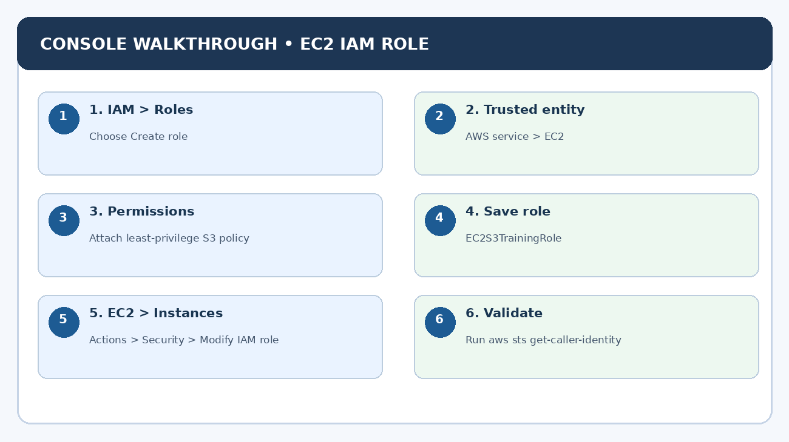


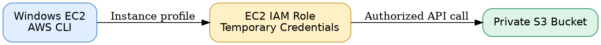

<details>
<summary>Editable Mermaid source for this diagram</summary>

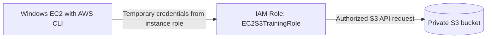

</details>

1. IAM → Roles → Create role.
2. Trusted entity: **AWS service**; use case: **EC2**.
3. Attach `TechGenieS3ReadOnly` (and separately scoped `PutObject` permission for uploads, if needed).
4. Name the role `EC2S3TrainingRole` and create it.
5. EC2 → Instances → select instance → Actions → Security → Modify IAM role.
6. Choose `EC2S3TrainingRole` and save. Check existing role dependencies before replacing any role.
7. Connect to Windows EC2 using RDP and open PowerShell.

```powershell
aws sts get-caller-identity
aws s3 ls s3://techgenie-s3-lab-unique12345/
aws s3 cp s3://techgenie-s3-lab-unique12345/welcome.txt C:\Users\Administrator\Downloads\welcome.txt
```

The CLI can automatically obtain temporary credentials through the EC2 instance metadata service. Network connectivity to S3 and suitable IAM permissions are still required. A gateway VPC endpoint can provide S3 access from private subnets.

# Part 6 – Versioning

## 21. Why versioning?

Without versioning, overwriting `project.txt` generally replaces the prior content. With versioning, S3 can retain multiple versions for recovery.

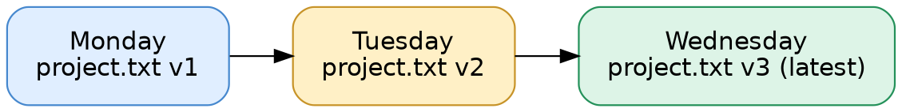

<details>
<summary>Editable Mermaid source for this diagram</summary>

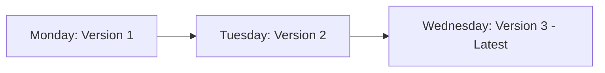

</details>

## 22. Lab 13 – Enable and test versioning

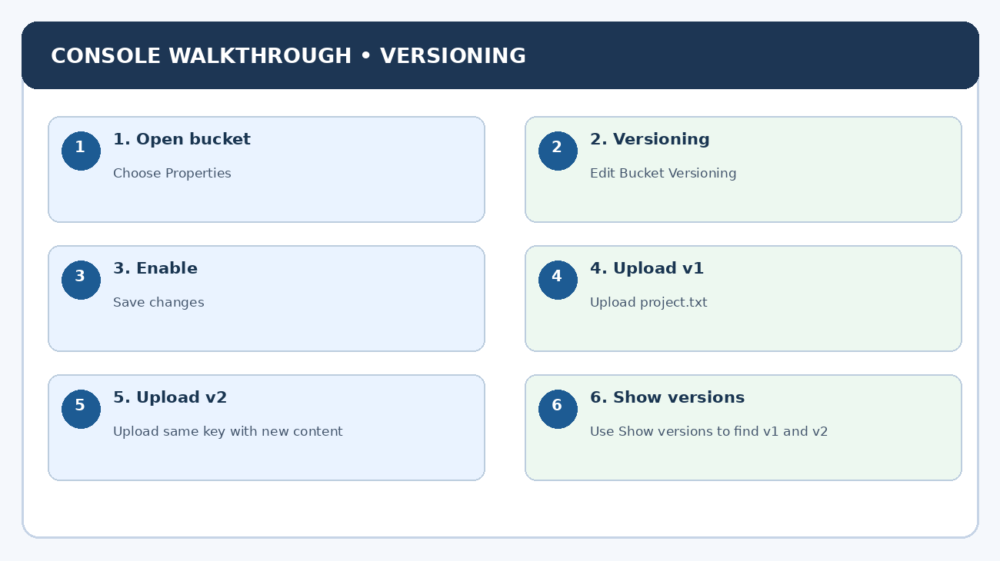


Console: Bucket → Properties → Bucket Versioning → Edit → Enable → Save.

```powershell
aws s3api put-bucket-versioning --bucket techgenie-s3-lab-unique12345 --versioning-configuration Status=Enabled --profile BirlaSoft
aws s3api get-bucket-versioning --bucket techgenie-s3-lab-unique12345 --profile BirlaSoft
```

Expected status: `Enabled`.

```powershell
"Version 1" | Set-Content C:\S3Training\project.txt
aws s3 cp C:\S3Training\project.txt s3://techgenie-s3-lab-unique12345/project.txt --profile BirlaSoft
"Version 2" | Set-Content C:\S3Training\project.txt
aws s3 cp C:\S3Training\project.txt s3://techgenie-s3-lab-unique12345/project.txt --profile BirlaSoft
aws s3api list-object-versions --bucket techgenie-s3-lab-unique12345 --prefix project.txt --profile BirlaSoft
```

Restore a chosen version:

```powershell
aws s3api get-object --bucket techgenie-s3-lab-unique12345 --key project.txt --version-id YOUR_VERSION_ID C:\S3Training\restored-project.txt --profile BirlaSoft
```

Replace `YOUR_VERSION_ID` with an actual returned version ID. Older versions incur storage costs; suspending versioning does not remove them.


# Part 7 – Encryption

## 23. Encryption in transit and at rest

| Type | Example |
|---|---|
| In transit | HTTPS/TLS |
| At rest | SSE-S3 or SSE-KMS |

S3 automatically encrypts new uploads at rest with SSE-S3 as a baseline. SSE-KMS adds KMS key controls and potential charges.

```powershell
aws s3api get-bucket-encryption --bucket techgenie-s3-lab-unique12345 --profile BirlaSoft
aws s3api put-bucket-encryption --bucket techgenie-s3-lab-unique12345 --server-side-encryption-configuration '{"Rules":[{"ApplyServerSideEncryptionByDefault":{"SSEAlgorithm":"AES256"}}]}' --profile BirlaSoft
```

The JSON quoting above is PowerShell-specific; a `file://` JSON configuration file is a portable alternative.

# Part 8 – Real-time project: EC2 backup to S3

## 24. Project architecture

A Windows EC2 application server creates timestamped ZIP backups and uploads them to a private S3 bucket using an IAM role.

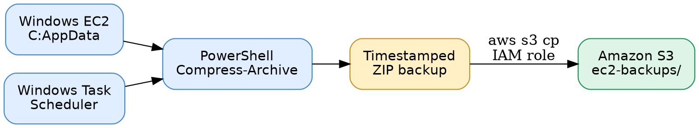

<details>
<summary>Editable Mermaid source for this diagram</summary>

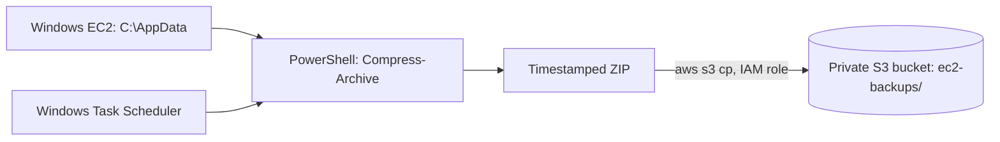

</details>

## 25. Lab 17 – PowerShell backup script

Save as `C:\Scripts\BackupToS3.ps1`:

```powershell
$ErrorActionPreference = "Stop"

$source = "C:\AppData"
$backupDir = "C:\Backups"
$bucket = "techgenie-s3-lab-unique12345"
$date = Get-Date -Format "yyyyMMdd-HHmmss"
$zipFile = "$backupDir\AppBackup-$date.zip"

New-Item -ItemType Directory -Path $backupDir -Force | Out-Null

if (-not (Test-Path $source)) {
    throw "Source folder does not exist: $source"
}

Compress-Archive -Path "$source\*" -DestinationPath $zipFile -Force

aws s3 cp $zipFile "s3://$bucket/ec2-backups/"

if ($LASTEXITCODE -ne 0) {
    throw "S3 upload failed"
}

Write-Host "Backup uploaded successfully: $zipFile"
```

| Command | Purpose |
|---|---|
| `Get-Date` | Timestamp |
| `New-Item` | Create backup directory |
| `Test-Path` | Validate source |
| `Compress-Archive` | ZIP files |
| `aws s3 cp` | Upload |
| `$LASTEXITCODE` | Check CLI exit code |
| `throw` | Stop on error |

Requires `s3:PutObject` for `ec2-backups/`, an existing source folder, and sufficient local disk space. It is a basic file-backup demo, not a transactionally consistent database backup.

Run:

```powershell
powershell.exe -NoProfile -File C:\Scripts\BackupToS3.ps1
```

**Schedule:** Task Scheduler → Create Task → name `DailyS3Backup` → Daily trigger → Start a program `powershell.exe` → arguments:

```text
-NoProfile -NonInteractive -File "C:\Scripts\BackupToS3.ps1"
```

Test manually. Production backups need logging, monitoring, integrity checks, restore testing, and retention controls.


## 26. Best practices

1. Keep Block Public Access enabled for private buckets.
2. Prefer IAM roles and temporary credentials.
3. Follow least privilege.
4. Enable versioning for important objects with retention controls.
5. Use lifecycle rules to control old data.
6. Use SSE-KMS when business controls require it.
7. Enable appropriate logging and monitoring.
8. Consider replication for disaster recovery.
9. Use pre-signed URLs for temporary access to private objects.
10. Configure AWS budgets and alerts.

# Part 9 – Troubleshooting

## 27. Common errors

| Error | Likely cause | Action |
|---|---|---|
| `AccessDenied` | Missing permission / explicit deny | Check IAM, bucket, SCP, KMS |
| `BucketAlreadyExists` | Name unavailable | Choose unique name |
| `NoSuchBucket` | Wrong bucket | Verify name |
| `NoSuchKey` | Wrong key | Check full case-sensitive key |
| `Unable to locate credentials` | No usable credentials | Role or SSO |
| `InvalidAccessKeyId` | Invalid/inactive key | Verify approved credentials |
| `PermanentRedirect` | Region mismatch | Correct Region |
| KMS access denied | Missing KMS rights | Check key and IAM policies |
| Timeout | Network / DNS / proxy | Check connectivity |

```powershell
aws sts get-caller-identity --profile BirlaSoft
aws s3api get-bucket-location --bucket techgenie-s3-lab-unique12345 --profile BirlaSoft
aws s3 ls s3://techgenie-s3-lab-unique12345/ --recursive --profile BirlaSoft
aws s3api get-public-access-block --bucket techgenie-s3-lab-unique12345 --profile BirlaSoft
aws s3api get-bucket-versioning --bucket techgenie-s3-lab-unique12345 --profile BirlaSoft
```

A successful identity check does not by itself prove S3 permissions.

# Part 10 – Trainee assignment

## 28. Department file-management assignment

- [ ] Create a private S3 bucket in `ap-south-1`.
- [ ] Create `development/`, `testing/`, and `backups/` prefixes.
- [ ] Upload `employees.csv` through the Console.
- [ ] Upload `welcome.txt` through PowerShell.
- [ ] Download using AWS CLI.
- [ ] Create a read-only IAM policy.
- [ ] Create a policy for upload to `development/` only.
- [ ] Enable versioning and upload two versions.
- [ ] Attach an S3 role to EC2.
- [ ] Upload from EC2 without access keys.
- [ ] Demonstrate automated backup.


# Part 11 – Interview and recap Q&A

1. **What is S3?** AWS object storage for files, backups, logs, and data lakes.
2. **Bucket vs object?** Bucket is container; object is data, key, and metadata.
3. **Can two buckets have the same name?** Not within the applicable bucket namespace; traditional general-purpose names are unique across the AWS partition.
4. **Can a bucket's Region be changed?** No; create a new bucket and migrate data.
5. **What is versioning?** Multiple retained variants under one key.
6. **S3 vs EBS?** S3 is API-based object storage; EBS is block storage for EC2.
7. **`cp` vs `sync`?** Copy specified files vs compare and synchronize directories/prefixes.
8. **EC2 to S3 without keys?** Attach an IAM role and use temporary instance credentials.
9. **Lifecycle rule?** Automatically transition or expire eligible objects/versions.
10. **Pre-signed URL?** Time-limited signed request for a specific S3 operation.
11. **Why Block Public Access?** Helps prevent accidental public exposure.
12. **SSE-S3 vs SSE-KMS?** S3-managed encryption keys vs AWS KMS key controls.
13. **Can S3 host websites?** Static content; CloudFront with private S3 origin is generally preferred for HTTPS.
14. **Delete in versioned bucket?** Ordinary delete typically creates a delete marker; old versions remain.
15. **Does S3 require EC2?** No, it is independent managed object storage.

# Part 12 – Cleanup

## 35. Remove training resources

For a **non-versioned** bucket:

```powershell
aws s3 rm s3://techgenie-s3-lab-unique12345/ --recursive --profile BirlaSoft
```

**Warning:** In a versioned bucket, this does not permanently remove all versions and delete markers. To fully empty it, use the Console **Empty** bucket operation (and confirm permanent deletion). After the bucket is empty:

```powershell
aws s3api delete-bucket --bucket techgenie-s3-lab-unique12345 --region ap-south-1 --profile BirlaSoft
```

Also remove training-only roles, policies, and scheduled tasks after checking for dependencies.

