# AWS VPC and Subnet — Complete Hands-on Tutorial

> **Lab scenario:** Company ABC has four employees: **A and B are Developers**, and **C and D are Testers**. We will show communication within the same subnet, across subnets, through the internet, and through VPC peering to Company XYZ.

<details open>
<summary><strong>1. What is a VPC? — Concept and first diagram</strong></summary>

**VPC stands for Virtual Private Cloud.** A VPC is a logically isolated network inside AWS in which you control IP ranges, subnets, routing, and network permissions.

Think of it as your company's private office network, but the computers are EC2 virtual machines hosted in AWS.

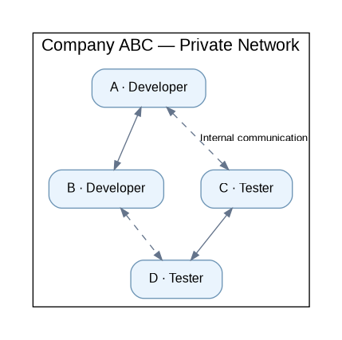


We create the AWS VPC named `CompanyABC-VPC` and launch four EC2 instances to represent these employees.

**Important:** A private network path does not itself allow all traffic: security groups, network ACLs, and Windows Defender Firewall can still block connections.

</details>

<details>
<summary><strong>2. What is a subnet, and why use it? — Developer versus Tester diagram</strong></summary>

A **subnet is a smaller IP network inside a VPC**. We divide our company into Development and Testing network segments.

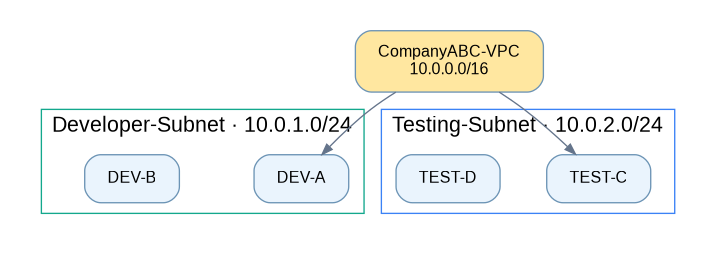


Why create subnets?

1. **Organization:** Separate development, testing, application, and database systems.
2. **Security design:** Apply different routing, access controls, and other policies.
3. **Internet design:** Use public and private subnets for different workloads.
4. **Availability:** Distribute subnets across Availability Zones for resilience.

**Caution:** A subnet does not automatically isolate traffic from another subnet in the same VPC. Configure the relevant security controls.

</details>

<details>
<summary><strong>3. IP addresses and CIDR — Full address plan</strong></summary>

CIDR defines the IPv4 address range in a VPC or subnet.

| Resource | CIDR |
|---|---|
| Company ABC VPC | `10.0.0.0/16` |
| Developer subnet | `10.0.1.0/24` |
| Testing subnet | `10.0.2.0/24` |
| Company XYZ VPC (later) | `10.1.0.0/16` |

- `10.0.0.0/16`: 65,536 IPv4 addresses in total.
- `10.0.1.0/24`: 256 IPv4 addresses in total.
- AWS reserves 5 addresses per subnet, leaving **251 usable IPv4 addresses** in a `/24`.

| Employee | Department | EC2 name | Private IP |
|---|---|---|---|
| A | Developer | `DEV-A` | `10.0.1.10` |
| B | Developer | `DEV-B` | `10.0.1.11` |
| C | Tester | `TEST-C` | `10.0.2.10` |
| D | Tester | `TEST-D` | `10.0.2.11` |

We deliberately set these private IPs when launching the servers.

</details>

<details>
<summary><strong>4. What is an Internet Gateway? — Diagram and explanation</strong></summary>

An **Internet Gateway (IGW)** is a component attached to a VPC that supports a path between the VPC and the public internet.

Examples:

- DEV-A requests a website hosted by another company.
- DEV-B calls a public REST API.
- An external customer opens an IIS site on one of our public EC2 servers.

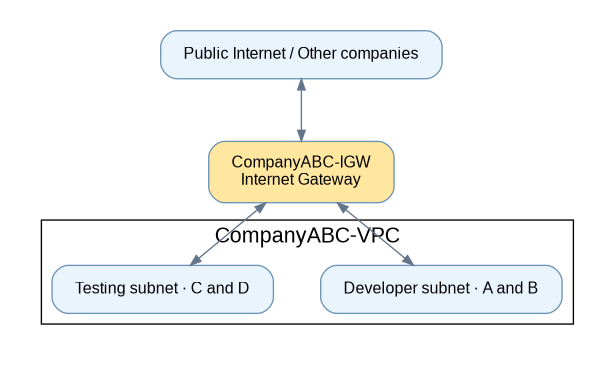

<details>
<summary>View original editable Mermaid source for diagram 3</summary>

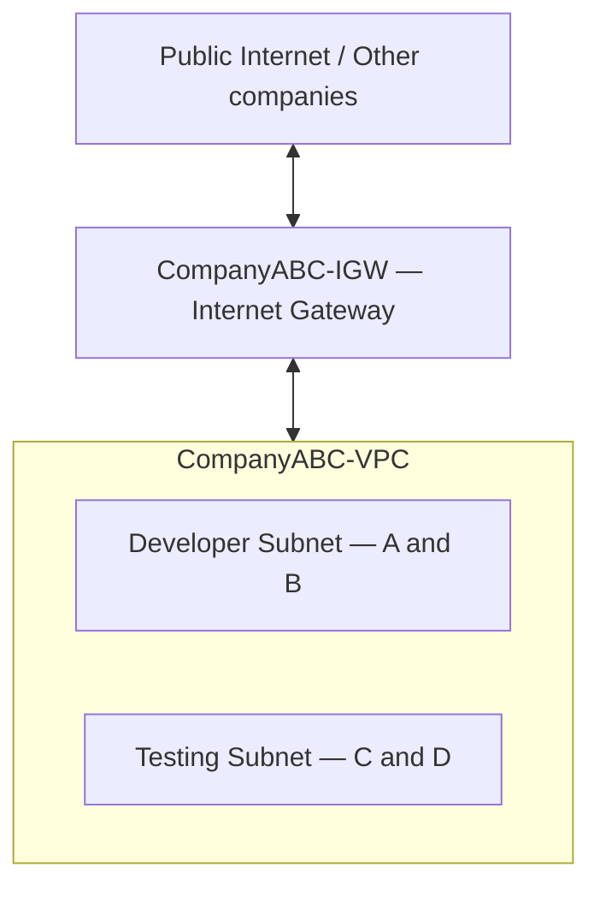

</details>

For **direct IPv4 internet communication**, a public EC2 normally requires **(1) a public IPv4 address, (2) a route to the Internet Gateway, and (3) security permissions**. Merely attaching an IGW does not make an instance accessible.

AWS reference: [Internet gateways](https://docs.aws.amazon.com/vpc/latest/userguide/VPC_Internet_Gateway.html).

</details>

<details>
<summary><strong>5. Overall architecture — All four EC2 instances and public access diagram</strong></summary>

For the **initial classroom lab**, both subnets are public to simplify direct RDP access. Later we introduce private subnets.

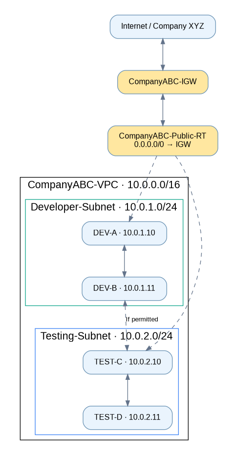

<details>
<summary>View original editable Mermaid source for diagram 4</summary>

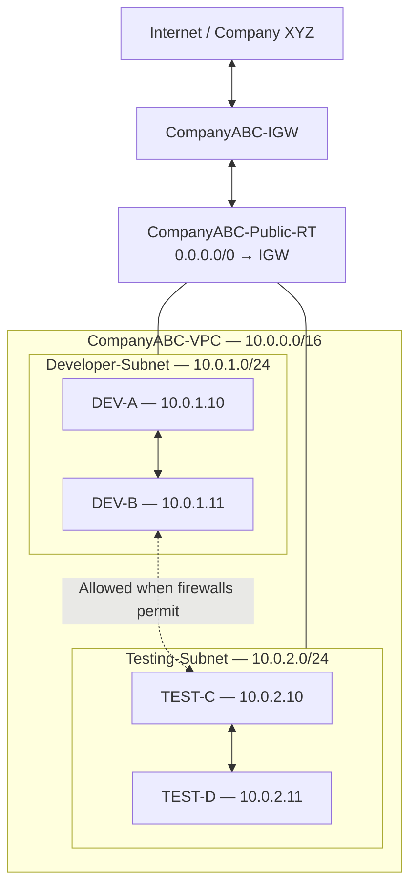

</details>

| Test | Expected result |
|---|---|
| A → B by private IP | Allowed |
| C → D by private IP | Allowed |
| A → C by private IP | Allowed if permitted |
| A → C on deliberately blocked port | Blocked |
| A → external public website | Allowed |
| External user → A on HTTP 80 | Allowed if configured |
| External user → A on unallowed port 5000 | Blocked |

The lab demonstrates the difference between **routing** and **security permissions**.

</details>

<details>
<summary><strong>6. Step 1 — Open AWS VPC Console and select Region</strong></summary>

1. Open [Amazon VPC Console](https://console.aws.amazon.com/vpc/).
2. Choose **Asia Pacific (Mumbai)**, Region `ap-south-1`.
3. Keep all VPC, subnets, EC2, Internet Gateway, and related resources in this Region.
4. Locate **Your VPCs**, **Subnets**, **Route tables**, **Internet gateways**, and **Security groups** in the VPC navigation.

</details>

<details>
<summary><strong>7. Step 2 — Create CompanyABC-VPC</strong></summary>

Go to **Your VPCs → Create VPC**.

| Field | Value | Reason |
|---|---|---|
| Resources to create | VPC only | We create other resources manually for learning |
| Name tag | `CompanyABC-VPC` | Company network identifier |
| IPv4 CIDR | Manual input | Choose our own range |
| IPv4 CIDR value | `10.0.0.0/16` | Address space for multiple subnets |
| IPv6 CIDR | No IPv6 CIDR block | Simplify first lab |
| Tenancy | Default | Standard EC2 tenancy |

Select **Create VPC**.

AWS creates the VPC and default supporting objects (main route table, default network ACL, default security group), but **does not create our custom subnets or IGW** when using **VPC only**.

</details>

<details>
<summary><strong>8. Step 3 — Create Developer subnet</strong></summary>

1. Navigate to **Subnets → Create subnet**.
2. Select VPC `CompanyABC-VPC`.
3. Supply these settings:

| Field | Value |
|---|---|
| Subnet name | `Developer-Subnet` |
| Availability Zone | Example: `ap-south-1a` |
| IPv4 subnet CIDR block | `10.0.1.0/24` |

4. Click **Create subnet**.

EC2 instances DEV-A and DEV-B will live here.

</details>

<details>
<summary><strong>9. Step 4 — Create Testing subnet</strong></summary>

Repeat the subnet creation process.

| Field | Value |
|---|---|
| VPC | `CompanyABC-VPC` |
| Subnet name | `Testing-Subnet` |
| Availability Zone | Same AZ as Developer subnet for this demonstration |
| IPv4 subnet CIDR block | `10.0.2.0/24` |

Click **Create subnet**. Both subnets are inside the same VPC. For a production design, distribute appropriately across multiple Availability Zones.

</details>

<details>
<summary><strong>10. Step 5 — Public IP assignment for classroom RDP</strong></summary>

New nondefault subnets might not automatically assign public IPv4 addresses.

For this lab, leave subnet-level auto-assign disabled if desired and explicitly select **Auto-assign public IP: Enable** while launching each EC2 instance. This demonstrates that:

- **Public subnet status** is determined by its associated route to an Internet Gateway.
- **Public IPv4 assignment** is configured for the instance/network interface.

Both are required for direct IPv4 internet access.

</details>

<details>
<summary><strong>11. Step 6 — Create and attach CompanyABC-IGW</strong></summary>

1. Navigate to **Internet gateways → Create internet gateway**.
2. Set name tag `CompanyABC-IGW`.
3. Click **Create internet gateway**.
4. Select the IGW → **Actions → Attach to VPC**.
5. Select `CompanyABC-VPC` → **Attach internet gateway**.

At this stage the IGW is attached, but **the subnets still need routing** before they can use it.

</details>

<details>
<summary><strong>12. Step 7 — Create public route table, inspect routes, and simulate route selection</strong></summary>

1. Go to **Route tables → Create route table**.
2. Name: `CompanyABC-Public-RT`.
3. VPC: `CompanyABC-VPC`.
4. Create it, select it, then choose **Routes → Edit routes → Add route**.

| Destination | Target |
|---|---|
| `10.0.0.0/16` | `local` — created automatically |
| `0.0.0.0/0` | Internet Gateway `CompanyABC-IGW` |

5. Save changes.

**Route examples:**

- DEV-A → `10.0.2.10` (TEST-C): matching route `10.0.0.0/16 → local`. The connection stays inside the VPC, not through the IGW.
- DEV-A → public IP `8.8.8.8`: matching route `0.0.0.0/0 → IGW`, assuming public IP assignment and permitted traffic.

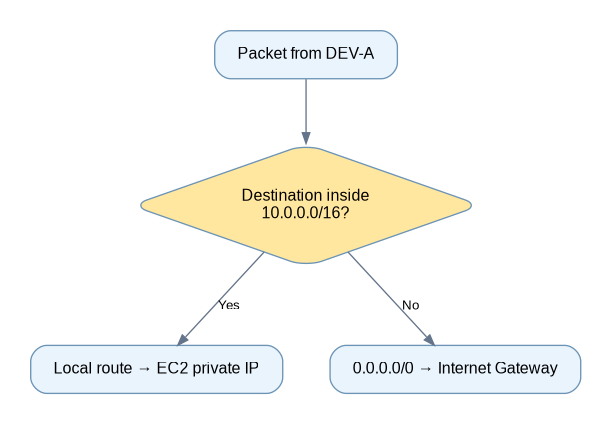

<details>
<summary>View original editable Mermaid source for diagram 5</summary>

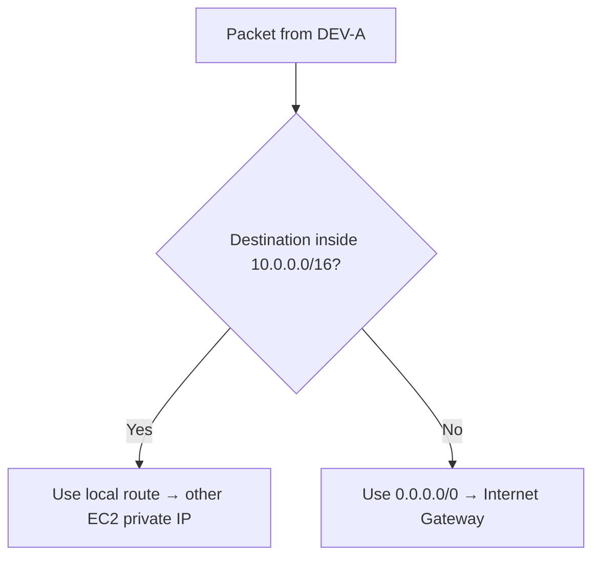

</details>

AWS generally uses the **most specific matching route** (longest prefix match).

AWS reference: [Route tables](https://docs.aws.amazon.com/vpc/latest/userguide/VPC_Route_Tables.html).

</details>

<details>
<summary><strong>13. Step 8 — Associate both subnets with public route table</strong></summary>

1. Select `CompanyABC-Public-RT`.
2. Open **Subnet associations → Edit subnet associations**.
3. Select both `Developer-Subnet` and `Testing-Subnet`.
4. Save associations.

Both become **public subnets** because their associated route table has a default route to the IGW. This does not automatically open their instance ports to the public.

</details>

<details>
<summary><strong>14. Part 3 — Create Developer-SG and Tester-SG security groups</strong></summary>

A security group is a stateful AWS virtual firewall attached to network interfaces. Create the following in **EC2 Console → Network & Security → Security Groups → Create security group**. Choose `CompanyABC-VPC`.

| Security group | Applied to |
|---|---|
| `Developer-SG` | DEV-A and DEV-B |
| `Tester-SG` | TEST-C and TEST-D |

**Developer-SG inbound rules**

| Type | Port | Source | Purpose |
|---|---|---|---|
| RDP | 3389 | My IP (`your-public-IP/32`) | RDP from your laptop |
| HTTP | 80 | `0.0.0.0/0` | Publish IIS demonstration |
| Custom TCP | 5000 | `10.0.0.0/16` | Internal app test |
| All ICMP – IPv4 | All | `10.0.0.0/16` | Internal ping |

**Tester-SG inbound rules**

| Type | Port | Source | Purpose |
|---|---|---|---|
| RDP | 3389 | My IP (`your-public-IP/32`) | RDP from your laptop |
| HTTP | 80 | `10.0.0.0/16` | Internal IIS tests only |
| Custom TCP | 5000 | `10.0.0.0/16` | Internal app tests |
| All ICMP – IPv4 | All | `10.0.0.0/16` | Internal ping |

For this initial lab, leave the default outbound allow-all rule. Later tighten outbound access.

**Why My IP for RDP?** `0.0.0.0/0` on port 3389 allows connection attempts from anywhere, creating unnecessary exposure. Prefer your public IP with `/32`.

**Also check Windows Defender Firewall**, which is separate from the AWS security group.

</details>

<details>
<summary><strong>15. Part 4, Step 9 — Launch DEV-A Windows Server 2022 with IIS user data</strong></summary>

Go to [Amazon EC2 Console](https://console.aws.amazon.com/ec2/) → **Instances → Launch instances**.

| Option | Selection |
|---|---|
| AMI | Microsoft Windows Server 2022 Base, x86_64 |
| Instance type | `t3.small` if available; consider `t3.medium` for usable RDP performance |
| Key pair | New RSA key pair, `.pem` file |
| VPC | `CompanyABC-VPC` |
| Subnet | `Developer-Subnet` |
| Auto-assign public IP | Enable |
| Storage | AMI default root EBS volume (often around 30 GiB) |

**DEV-A details:**

| Setting | Value |
|---|---|
| Name | `DEV-A` |
| Key pair | `CompanyABC-Key.pem` |
| Security group | `Developer-SG` |
| Primary private IPv4 address | `10.0.1.10` |

Expand **Network settings**, choose **Edit** if needed, and use network interface advanced settings to specify the primary private IPv4 address.

Under **Advanced details → User data**, paste this PowerShell user-data script:

```powershell
<powershell>
Install-WindowsFeature -Name Web-Server -IncludeManagementTools

New-NetFirewallRule -DisplayName "Allow HTTP 80" `
  -Direction Inbound -Protocol TCP -LocalPort 80 -Action Allow

New-NetFirewallRule -DisplayName "Allow Ping IPv4" `
  -Direction Inbound -Protocol ICMPv4 -IcmpType 8 `
  -RemoteAddress 10.0.0.0/16 -Action Allow

Set-Content -Path "C:\inetpub\wwwroot\index.html" `
  -Value "<h1>Hello from Developer A</h1><p>Company ABC</p>"
</powershell>
```

What this does:

1. Installs the IIS web server role and management tools.
2. Allows incoming TCP port 80 through Windows Firewall.
3. Allows private VPC ICMP ping requests.
4. Writes a simple IIS home page identifying Developer A.

Choose **Launch instance**. Windows user data normally runs during initial boot. Verify initialization finishes before testing the page.

**Cost warning:** Four or five Windows instances plus EBS storage and public IPv4 addresses incur charges; the lab is not guaranteed to be free. Check regional pricing. `t3.small` with 2 GiB RAM may be slow; `t3.medium` is more comfortable, but more costly.

</details>

<details>
<summary><strong>16. Step 10 — Launch DEV-B, TEST-C, and TEST-D</strong></summary>

Repeat the EC2 launch procedure with the same Windows AMI, appropriate subnet, public IP setting, RSA key, storage, and security group.

| EC2 | Subnet | Private IP | Security group |
|---|---|---|---|
| DEV-A | Developer-Subnet | `10.0.1.10` | Developer-SG |
| DEV-B | Developer-Subnet | `10.0.1.11` | Developer-SG |
| TEST-C | Testing-Subnet | `10.0.2.10` | Tester-SG |
| TEST-D | Testing-Subnet | `10.0.2.11` | Tester-SG |

Reuse the IIS user-data script for each server, changing the HTML heading to e.g. `Hello from Developer B`, `Hello from Tester C`, and `Hello from Tester D`. Alternatively, update the page after logging in.

</details>

<details>
<summary><strong>17. Step 11 — Connect using RDP, decrypt Administrator password, verify IIS</strong></summary>

For DEV-A:

1. In EC2 **Instances**, select DEV-A → **Connect**.
2. Choose **RDP client**.
3. Select **Get password**.
4. Upload the `.pem` **private key** you downloaded when you created the key pair.
5. Select **Decrypt password**.
6. Copy the generated Windows Administrator password.
7. On your Windows laptop, run `mstsc` (Remote Desktop Connection).
8. Enter DEV-A's **public IPv4 address**.
9. Sign in as `Administrator` using the decrypted password.
10. Repeat for DEV-B, TEST-C, and TEST-D.

**The `.pem` key decrypts the Windows Administrator password. It is not itself the RDP password.**

Run these commands in Administrator PowerShell on each EC2:

```powershell
hostname
ipconfig
Get-NetIPAddress -AddressFamily IPv4
Get-Service W3SVC
```

Confirm the expected private IPv4 and that IIS (`W3SVC`) is running.

</details>

<details>
<summary><strong>18. Part 5, Step 12 — DEV-A talks to DEV-B using private IP</strong></summary>

Connect to DEV-A through RDP and run:

```powershell
Test-Connection 10.0.1.11 -Count 4
```

This sends 4 ICMP requests to DEV-B. Replies are expected when both Windows firewall and AWS security groups permit ICMP.

Next test IIS:

```powershell
Test-NetConnection 10.0.1.11 -Port 80
Invoke-WebRequest http://10.0.1.11 -UseBasicParsing
```

If working, `TcpTestSucceeded : True` appears and DEV-B's IIS page content is returned.

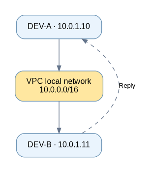

<details>
<summary>View original editable Mermaid source for diagram 6</summary>

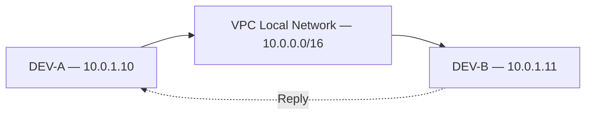

</details>

**Internet Gateway is not required** for private IP communication between A and B.

</details>

<details>
<summary><strong>19. Step 13 — DEV-A talks to TEST-C across two subnets</strong></summary>

From DEV-A run:

```powershell
Test-Connection 10.0.2.10 -Count 4
Test-NetConnection 10.0.2.10 -Port 80
Invoke-WebRequest http://10.0.2.10 -UseBasicParsing
```

The **VPC local route** makes inter-subnet communication possible; firewall rules still control whether each connection is accepted.

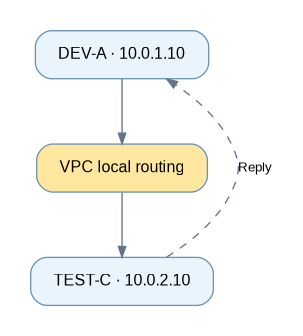

<details>
<summary>View original editable Mermaid source for diagram 7</summary>

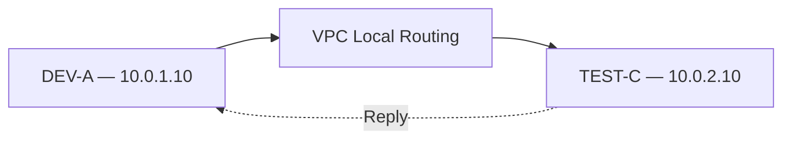

</details>

**Key concept:** Two subnets within the same VPC communicate over private IPs without using an IGW.

</details>

<details>
<summary><strong>20. Step 14 — Demonstrate TCP port 5000: no listener, allowed, then blocked</strong></summary>

First, on DEV-A:

```powershell
Test-NetConnection 10.0.2.10 -Port 5000
```

Initially, although `Tester-SG` permits port 5000 from the VPC, no application listens on this port, so it should fail.

On TEST-C, run **Administrator PowerShell**:

```powershell
New-NetFirewallRule -DisplayName "Demo Port 5000" `
  -Direction Inbound -Protocol TCP `
  -LocalPort 5000 -RemoteAddress 10.0.0.0/16 `
  -Action Allow

$listener = [System.Net.HttpListener]::new()
$listener.Prefixes.Add("http://+:5000/")
$listener.Start()

Write-Host "Demo server running on port 5000"

while ($listener.IsListening) {
    $context = $listener.GetContext()
    $body = [Text.Encoding]::UTF8.GetBytes(
        "Hello from TEST-C on port 5000"
    )
    $context.Response.ContentType = "text/plain"
    $context.Response.ContentLength64 = $body.Length
    $context.Response.OutputStream.Write($body, 0, $body.Length)
    $context.Response.Close()
}
```

Keep the PowerShell console running. If the listener fails with Access Denied, ensure it is an Administrator PowerShell window.

From DEV-A:

```powershell
Test-NetConnection 10.0.2.10 -Port 5000
Invoke-WebRequest http://10.0.2.10:5000 -UseBasicParsing
```

Expected content: `Hello from TEST-C on port 5000`.

**Demonstrate a true security-group block:**

1. In AWS EC2, open TEST-C's `Tester-SG`.
2. Choose **Edit inbound rules**.
3. Remove the TCP port `5000` rule; save.
4. Test port 5000 again from DEV-A. Connection should now fail while the app is running.
5. Restore the TCP 5000 inbound rule, source `10.0.0.0/16`, and test again. It should succeed.
6. On TEST-C, stop the listener with Ctrl+C when done.

**Lesson:** Route tables determine *where* traffic is sent. Security groups and Windows Firewall determine *whether* the connection is permitted. Also verify an app is listening.

</details>

<details>
<summary><strong>21. Part 6, Scenario A — Company ABC talks to Company XYZ on the public internet</strong></summary>

Imagine Company XYZ runs a public website or REST API. DEV-A can access it over the internet through the Internet Gateway.

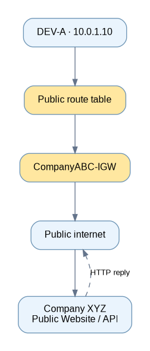

<details>
<summary>View original editable Mermaid source for diagram 8</summary>

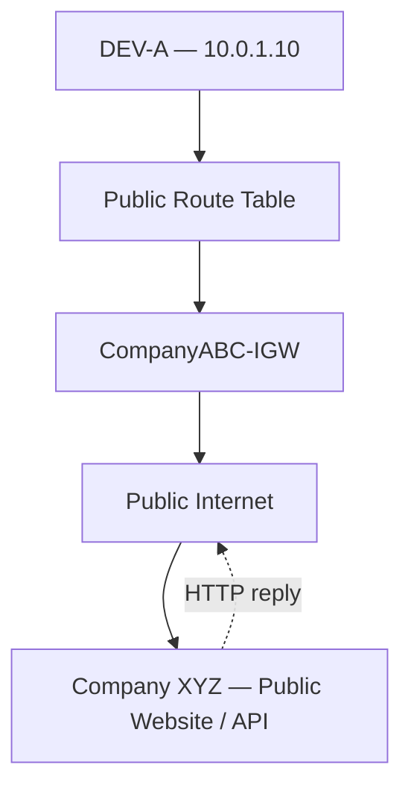

</details>

On DEV-A:

```powershell
Test-NetConnection example.com -Port 443
Invoke-WebRequest https://example.com -UseBasicParsing
```

Other-company users can likewise access a published IIS page on DEV-A using its public IPv4 address, if security groups, routes, and Windows Firewall allow HTTP 80:

```text
http://<DEV-A-PUBLIC-IP>
```

The other company **does not need access to our VPC** to consume a publicly published website or API.

</details>

<details>
<summary><strong>22. Part 6, Scenario B — Private company-to-company communication using VPC Peering</strong></summary>

Suppose Company XYZ has its own VPC with a private IP range. DEV-A wants to communicate privately with EMP-X.

- Company ABC VPC: `10.0.0.0/16`.
- Company XYZ VPC: `10.1.0.0/16`.
- Company XYZ employee X: `10.1.1.10`.

An **Internet Gateway alone is not enough** for access to another VPC's private IPs. Use a private network connection, e.g., **VPC Peering**.

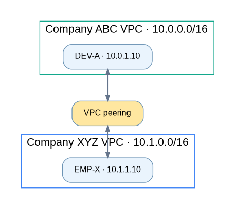

<details>
<summary>View original editable Mermaid source for diagram 9</summary>

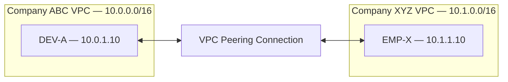

</details>

VPC peering can connect nonoverlapping VPCs within or across AWS Regions and across accounts, with the required routes and firewalls. Traffic uses AWS private networking, not a public internet path.

AWS reference: [VPC peering](https://docs.aws.amazon.com/vpc/latest/peering/what-is-vpc-peering.html).

</details>

<details>
<summary><strong>23. Step 15 — Optional: Create Company XYZ VPC, subnet and Windows EC2</strong></summary>

To simulate a second company in the same AWS account, create:

| Resource | Value |
|---|---|
| VPC | `CompanyXYZ-VPC` |
| VPC CIDR | `10.1.0.0/16` |
| Subnet | `XYZ-Subnet` |
| Subnet CIDR | `10.1.1.0/24` |
| EC2 | `EMP-X` — Windows Server 2022 |
| Private IP | `10.1.1.10` |

For simple RDP access in this lab, configure Company XYZ's own Internet Gateway and a public route table, assign EMP-X a public IPv4, and allow RDP from your IP.

For tests, allow ICMP and HTTP from `10.0.0.0/16` in EMP-X's security group and Windows Firewall. Install IIS and ensure it listens on port 80.

**Real-world note:** The other VPC might be owned by a different AWS account and need permission/acceptance from its owner.

</details>

<details>
<summary><strong>24. Step 16 — Create and accept ABC-to-XYZ VPC peering</strong></summary>

Navigate to **VPC Console → Peering connections → Create peering connection**.

| Field | Value |
|---|---|
| Name | `ABC-to-XYZ-Peering` |
| Requester VPC | `CompanyABC-VPC` |
| Accepter VPC | `CompanyXYZ-VPC` |
| Account | My account |
| Region | This Region |

Create the request, then select it → **Actions → Accept request** if acceptance is pending. Its status should become **Active**.

</details>

<details>
<summary><strong>25. Step 17 — Add cross-VPC routes in both directions</strong></summary>

**Company ABC:** Open `CompanyABC-Public-RT` and add:

| Destination | Target |
|---|---|
| `10.1.0.0/16` | VPC peering connection `ABC-to-XYZ-Peering` |

**Company XYZ:** Edit the route table associated with `XYZ-Subnet` and add:

| Destination | Target |
|---|---|
| `10.0.0.0/16` | Same VPC peering connection |

Keep existing local and internet routes. Both sides need reciprocal routes and appropriate firewall permissions.

</details>

<details>
<summary><strong>26. Step 18 — Test DEV-A to EMP-X using private IP</strong></summary>

Confirm EMP-X allows ICMP from `10.0.0.0/16` in both its security group and Windows Firewall. On DEV-A:

```powershell
Test-Connection 10.1.1.10 -Count 4
```

To test EMP-X's IIS website:

```powershell
Test-NetConnection 10.1.1.10 -Port 80
Invoke-WebRequest http://10.1.1.10 -UseBasicParsing
```

Expected result: private IP communication succeeds using the VPC peering connection, **not** Company ABC's Internet Gateway.

</details>

<details>
<summary><strong>27. Part 7 — Public versus private subnet comparison</strong></summary>

In the initial lab all four EC2s are in **public subnets** for easier RDP. A production architecture often uses **private subnets** for internal systems.

| Feature | Public subnet | Private subnet |
|---|---|---|
| Direct route to IGW | Yes | No |
| Direct inbound internet access to appropriately configured IPv4 EC2 | Possible | No |
| Private VPC communication | Yes, if permitted | Yes, if permitted |
| Public internet downloads | Via public IP + IGW | Via NAT, proxy, or other outbound access |
| Typical role | Public web tier/load balancer | Internal application/database tier |

A subnet is **private** if it lacks a direct route to the IGW. Private resources may still use an appropriate outbound gateway or endpoint.

</details>

<details>
<summary><strong>28. Secure architecture diagram — Public web tier, private developers/testers, NAT</strong></summary>

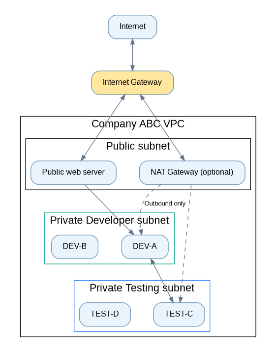

<details>
<summary>View original editable Mermaid source for diagram 10</summary>

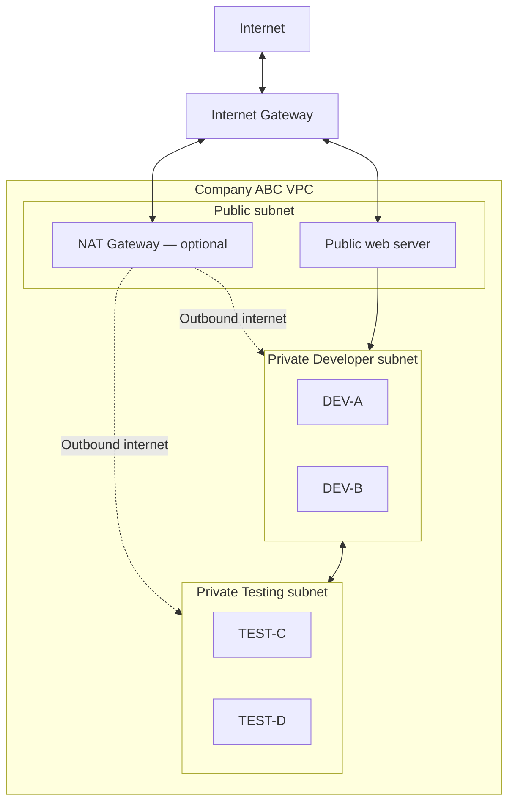

</details>

**Hands-on private subnet variant:**

1. Create `Private-Testing-Subnet`, CIDR `10.0.3.0/24` in `CompanyABC-VPC`.
2. Associate it with a route table containing only the VPC `local` route (no `0.0.0.0/0` to IGW).
3. Launch a test Windows EC2 without public IPv4.
4. Observe that direct public-internet RDP from your laptop is not possible.
5. Use an approved management path: properly configured AWS Systems Manager Session Manager, VPN, or a secured jump/bastion host.
6. If outbound public internet access is needed, use a NAT Gateway or other suitable mechanism with a private route table; NAT Gateway has hourly and data processing charges.

**Important:** NAT enables outbound initiated connections, not unsolicited inbound access to private EC2 instances.

</details>

<details>
<summary><strong>29. Part 8 — Complete student practical checklist</strong></summary>

- [ ] Create `CompanyABC-VPC` (`10.0.0.0/16`).
- [ ] Create `Developer-Subnet` and `Testing-Subnet`.
- [ ] Create and attach `CompanyABC-IGW`.
- [ ] Configure `CompanyABC-Public-RT` with `0.0.0.0/0 → IGW`.
- [ ] Associate both subnets with the public route table.
- [ ] Create `Developer-SG` and `Tester-SG`.
- [ ] Launch four Windows Server 2022 EC2s: DEV-A, DEV-B, TEST-C, TEST-D.
- [ ] Verify private IPs and IIS services.
- [ ] Test DEV-A → DEV-B private ping and HTTP.
- [ ] Test DEV-A → TEST-C cross-subnet ping and HTTP.
- [ ] Start a port 5000 HTTP server and verify it works.
- [ ] Remove security-group permission for port 5000 and prove it is blocked.
- [ ] Restore the rule and prove it works again.
- [ ] Access DEV-A IIS using its public IPv4 from an external browser.
- [ ] Create Company XYZ VPC and peer with Company ABC (optional).
- [ ] Test DEV-A → EMP-X private connectivity across VPC peering.
- [ ] Experiment with a genuinely private subnet (optional).
- [ ] Terminate lab instances and delete unused billable resources.

</details>

<details>
<summary><strong>30. Troubleshooting — RDP, ICMP, IIS, NAT, and VPC Peering</strong></summary>

| Problem | What to check |
|---|---|
| RDP connection times out | Public IP, subnet route, security-group inbound TCP 3389 from your IP, Windows Firewall, instance readiness |
| Ping fails | ICMP rules on destination security group and Windows Defender Firewall |
| Ping works but HTTP fails | IIS service, port 80 security group, Windows Firewall, correct IP and website |
| Private subnet cannot access public internet | Outbound route via NAT/proxy, associated security rules, DNS |
| VPC peering ping fails | Active peering, both route tables, nonoverlapping CIDRs, security groups, Windows Firewall |
| IIS page missing after launch | Check user-data initialization, IIS installation, web root file and service |

Remember: a ping failure alone does not prove an IP route is broken, because firewalls can block ICMP.

</details>

<details>
<summary><strong>31. Cleanup — Avoid unexpected AWS charges</strong></summary>

After the demonstration:

1. Terminate DEV-A, DEV-B, TEST-C, TEST-D, and EMP-X (if launched).
2. Confirm EBS volumes set to persist, if any, are not left unnecessarily.
3. Delete NAT Gateways and release unused Elastic IP addresses, if created.
4. Delete VPC peering connection if created.
5. Remove custom security groups and detach/delete custom Internet Gateways as appropriate.
6. Delete unused subnets and custom route tables.
7. Delete `CompanyABC-VPC` and `CompanyXYZ-VPC` once all dependencies are removed.
8. Check the EC2 and billing consoles for remaining chargeable resources, including public IPv4 addresses and EBS volumes.

AWS services and prices vary by Region and configuration. Windows EC2 instances and NAT Gateways are not necessarily within free-tier benefits.

</details>

<details>
<summary><strong>32. Final recap — Component, analogy, and purpose</strong></summary>

| AWS component | Real-world analogy | Purpose |
|---|---|---|
| VPC | Company's private campus | Logically isolated network |
| Subnet | Department/network segment | Organizes IP address space, routing association, and policies |
| EC2 | Employee's computer/server | Runs applications |
| Route table | Road directions | Determines next network hop |
| Security group | Access-control guard | Permits selected traffic to/from an instance |
| Internet Gateway | Connection to public roads | Public internet connectivity |
| NAT Gateway | Outbound internet access point | Allows private workloads to initiate outbound internet access |
| VPC Peering | Private connection between campuses | Connects two VPCs using private IP routes |

**Key message:** VPCs provide private network environments. Subnets organize those environments. Route tables decide packet destinations. Security groups control permitted connections. Internet Gateways enable public internet connectivity, while VPC peering enables private traffic between separate VPCs.

### Official references

- [Amazon VPC User Guide](https://docs.aws.amazon.com/vpc/latest/userguide/)
- [Internet Gateway documentation](https://docs.aws.amazon.com/vpc/latest/userguide/VPC_Internet_Gateway.html)
- [Route tables](https://docs.aws.amazon.com/vpc/latest/userguide/VPC_Route_Tables.html)
- [Security groups](https://docs.aws.amazon.com/vpc/latest/userguide/vpc-security-groups.html)
- [VPC Peering](https://docs.aws.amazon.com/vpc/latest/peering/what-is-vpc-peering.html)
- [Connect to a Windows instance using RDP](https://docs.aws.amazon.com/AWSEC2/latest/UserGuide/connect-rdp.html)

</details>

---

*End of tutorial — AWS VPC, Subnets, Internet Gateway, Windows Server EC2 communication, and cross-company VPC peering.*
